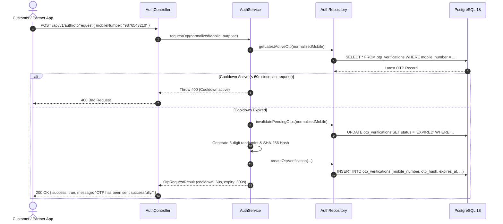
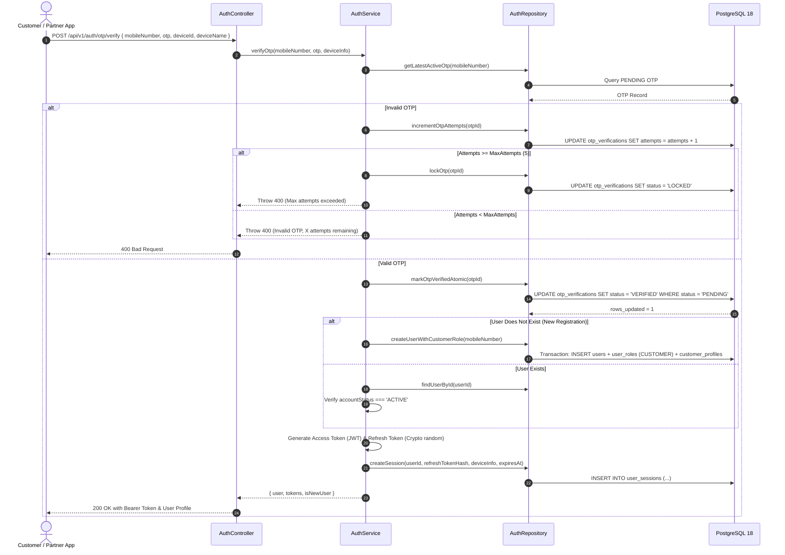
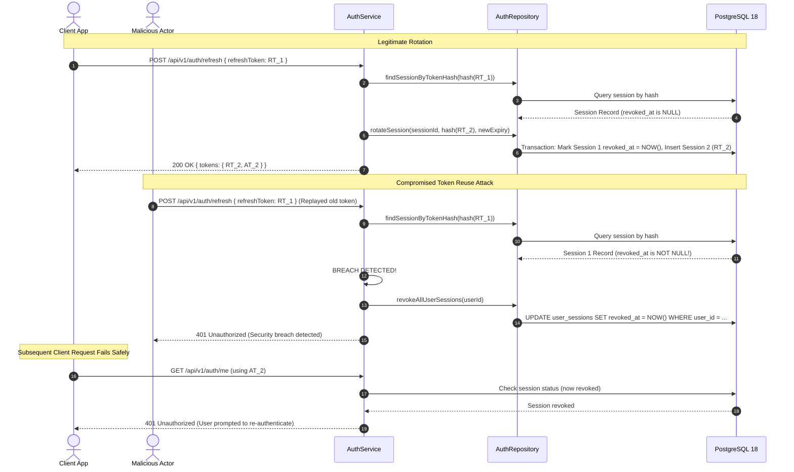
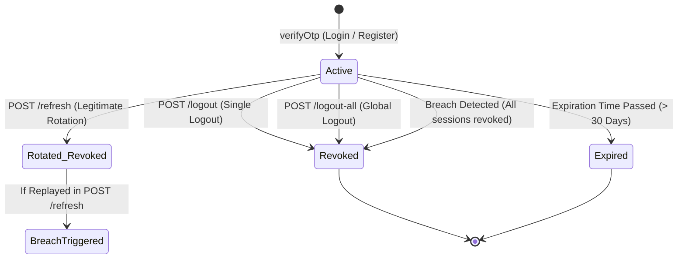

# Authentication & Session Architecture

## 1. Executive Summary

This document describes the architectural foundation for the **Mobile Number & OTP Authentication System** designed for the Multi-Service On-Demand Platform. The architecture adheres to a clean **Modular Monolith** pattern with clear layer isolation:

```
[HTTP Request / Controller] ──> [Validation Middleware (Zod)]
                                        │
                                        ▼
                                [Auth Service]
                                 ├── Token Util (JWT & SHA-256)
                                 ├── OTP Util (Crypto & Normalization)
                                 └── Logger (Winston)
                                        │
                                        ▼
                                [Auth Repository]
                                        │
                                        ▼
                           [PostgreSQL 18 via Prisma ORM]
                         (users, roles, user_roles, 
                          otp_verifications, user_sessions)
```

---

## 2. Architecture & Design Principles

1. **Passwordless Mobile First**: Authentication strictly relies on normalized Indian mobile numbers (`+91XXXXXXXXXX`) verified via cryptographic one-time passwords (OTP).
2. **Stateless Access with Stateful Session Invalidation**: Access Tokens are stateless RS256/HS256 JWTs (15-minute lifetime), while Refresh Tokens are opaque cryptographic 256-bit random strings stored as SHA-256 hashes in `user_sessions`.
3. **Refresh Token Rotation (RTR)**: Every time a refresh token is exchanged, a new refresh token is issued, and the prior session record is transitioned to revoked.
4. **Token Reuse Breach Detection**: If an already-rotated or revoked refresh token is presented, the system immediately recognizes a potential security breach, revoking all active sessions across all devices for that user.
5. **Zero Token/Password Persistence**: Plaintext tokens and plaintext OTPs are never stored in the database or written to logs. Only cryptographically salted SHA-256 hashes are persisted.
6. **Atomic Verification**: OTP verification utilizes atomic check-and-set updates in PostgreSQL to guarantee that concurrent verification attempts cannot cause race conditions or duplicate account creation.

---

## 3. End-to-End Authentication Workflows

### 3.1. OTP Request & Generation Flow



---

### 3.2. OTP Verification & Session Issuance Flow



---

### 3.3. Refresh Token Rotation & Breach Detection Flow



---

## 4. Session State Machine

Every session in `user_sessions` follows this strict finite state machine:



---

## 5. Role-Based Access Control (RBAC) Architecture

- Role definitions are seeded in the `roles` table:
  - `CUSTOMER`: End consumer requesting services or shifting.
  - `PARTNER`: Professional service provider or shifting vendor.
  - `DRIVER`: Vehicle operator.
  - `WORKER`: Loading and unloading specialist.
  - `ADMIN`: Operations manager.
  - `SUPER_ADMIN`: Root platform administrator.
- A user can hold **multiple roles simultaneously** via `user_roles`.
- Every generated JWT Access Token contains `roles: string[]` in its cryptographically signed payload.
- Middleware guards enforce strict least-privilege checks:
  - `requireAuth`: Verifies JWT signature and checks `user_sessions.revoked_at` in the database.
  - `requireRole(...roles)`: Verifies if the authenticated user has at least one of the permitted roles.
  - `requireCustomer`: Enforces `CUSTOMER` role.
  - `requirePartner`: Enforces `PARTNER` role.
  - `requireAdmin`: Enforces `ADMIN` or `SUPER_ADMIN` role.

