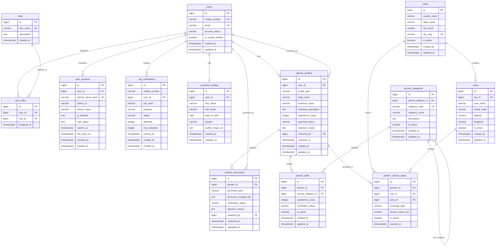

# Database Audit Report: `service_platform_db`

**Platform**: Multi-Service On-Demand Platform  
**Audit Date**: November 03, 2026  
**Auditor**: Senior Database Architect & Backend Engineer  
**Database Server**: PostgreSQL 18.6 (x86_64-windows)  
**Host**: 127.0.0.1:5432  
**Target Database**: `service_platform_db`  
**Authentication**: SCRAM-SHA-256 (via `.env` credentials)  
**Audit Scope**: Read-only structural inspection, constraints, indexes, relationships, and record volume verification.

---

## 1. Executive Summary

A complete, non-destructive, read-only audit of `service_platform_db` was performed.

- **Connectivity**: Verified. Successfully connected via local PostgreSQL 18 driver on port 5432.
- **Existing Tables**: **13 tables** exist in the `public` schema.
- **Planned Tables Missing**: `user_addresses` (planned in earlier development notes) has **not** yet been created.
- **Primary Keys**: All 13 tables strictly use `bigint GENERATED ALWAYS AS IDENTITY` as primary keys.
- **Data Integrity**: Clean foreign keys with explicit cascade/restrict rules exist across user identities, roles, locations, categories, and partner profiles.
- **Seeded Data**:
  - `roles`: 6 system roles pre-seeded (`CUSTOMER`, `PARTNER`, `DRIVER`, `WORKER`, `ADMIN`, `SUPER_ADMIN`).
  - `service_categories`: 14 categories pre-seeded (3 parent roots: `HOME_SERVICES`, `SHIFTING`, `VEHICLE_SERVICES`, plus 11 subcategories).
  - All transactional/user tables currently have **0 records** (Fresh staging/development environment).
- **Security & Privacy**: Zero personal data was exposed during the audit.

---

## 2. Table Inventory and Record Counts

| # | Table Name | Type | Record Count | Notes / Status |
| :--- | :--- | :--- | :--- | :--- |
| 1 | `users` | Base Table | 0 | Core user identities (mobile-centric) |
| 2 | `roles` | Base Table | 6 | Pre-seeded system roles |
| 3 | `user_roles` | Base Table | 0 | Many-to-Many user-role mappings |
| 4 | `otp_verifications` | Base Table | 0 | Mobile OTP verification lifecycle |
| 5 | `user_sessions` | Base Table | 0 | JWT refresh tokens and active sessions |
| 6 | `customer_profiles` | Base Table | 0 | 1-to-1 customer details |
| 7 | `partner_profiles` | Base Table | 0 | 1-to-1 partner KYC & onboarding status |
| 8 | `partner_documents` | Base Table | 0 | KYC verification documents (Aadhaar, PAN, DL, RC) |
| 9 | `service_categories`| Base Table | 14 | Pre-seeded hierarchical taxonomy |
| 10 | `partner_skills` | Base Table | 0 | Partner-to-Service Category associations |
| 11 | `cities` | Base Table | 0 | Serviceable cities catalog |
| 12 | `areas` | Base Table | 0 | Serviceable localities/neighborhoods within cities |
| 13 | `partner_service_areas` | Base Table | 0 | Operational coverage definitions for partners |

*Note: The planned `user_addresses` table does not exist in the database.*

---

## 3. Detailed Structural Inspection

### 3.1. `users`
- **Columns**:
  - `id`: `bigint` (NOT NULL, PK, GENERATED ALWAYS AS IDENTITY)
  - `mobile_number`: `varchar` (NOT NULL, UNIQUE)
  - `email`: `varchar` (NULLABLE, UNIQUE)
  - `account_status`: `varchar` (NOT NULL, DEFAULT `'ACTIVE'`, CHECK: `['ACTIVE', 'BLOCKED', 'DELETED']`)
  - `is_mobile_verified`: `boolean` (NOT NULL, DEFAULT `false`)
  - `created_at`: `timestamptz` (NOT NULL, DEFAULT `CURRENT_TIMESTAMP`)
  - `updated_at`: `timestamptz` (NOT NULL, DEFAULT `CURRENT_TIMESTAMP`)
- **Indexes**:
  - `users_pkey`: UNIQUE (`id`)
  - `users_mobile_number_key`: UNIQUE (`mobile_number`)
  - `users_email_key`: UNIQUE (`email`)

### 3.2. `roles`
- **Columns**:
  - `id`: `bigint` (NOT NULL, PK, GENERATED ALWAYS AS IDENTITY)
  - `role_name`: `varchar` (NOT NULL, UNIQUE)
  - `description`: `text` (NULLABLE)
  - `created_at`: `timestamptz` (NOT NULL, DEFAULT `CURRENT_TIMESTAMP`)
- **Pre-seeded Rows**:
  1. `CUSTOMER`: User who books services
  2. `PARTNER`: User who provides professional services
  3. `DRIVER`: User who drives vehicles
  4. `WORKER`: User who performs loading and unloading
  5. `ADMIN`: Platform administrator
  6. `SUPER_ADMIN`: Platform super administrator

### 3.3. `user_roles`
- **Columns**:
  - `id`: `bigint` (NOT NULL, PK, GENERATED ALWAYS AS IDENTITY)
  - `user_id`: `bigint` (NOT NULL, FK -> `users.id` ON DELETE CASCADE)
  - `role_id`: `bigint` (NOT NULL, FK -> `roles.id` ON DELETE RESTRICT)
  - `assigned_at`: `timestamptz` (NOT NULL, DEFAULT `CURRENT_TIMESTAMP`)
- **Constraints & Indexes**:
  - `uq_user_role`: UNIQUE (`user_id`, `role_id`)

### 3.4. `otp_verifications`
- **Columns**:
  - `id`: `bigint` (NOT NULL, PK, GENERATED ALWAYS AS IDENTITY)
  - `mobile_number`: `varchar` (NOT NULL)
  - `user_id`: `bigint` (NULLABLE, FK -> `users.id` ON DELETE SET NULL)
  - `otp_hash`: `varchar` (NOT NULL)
  - `purpose`: `varchar` (NOT NULL, DEFAULT `'AUTHENTICATION'`, CHECK: `['AUTHENTICATION', 'CHANGE_MOBILE', 'PASSWORD_RESET']`)
  - `status`: `varchar` (NOT NULL, DEFAULT `'PENDING'`, CHECK: `['PENDING', 'VERIFIED', 'EXPIRED', 'LOCKED']`)
  - `attempts`: `integer` (NOT NULL, DEFAULT 0, CHECK: `attempts >= 0 AND max_attempts > 0`)
  - `max_attempts`: `integer` (NOT NULL, DEFAULT 5)
  - `expires_at`: `timestamptz` (NOT NULL)
  - `verified_at`: `timestamptz` (NULLABLE)
  - `created_at`: `timestamptz` (NOT NULL, DEFAULT `CURRENT_TIMESTAMP`)
- **Indexes**:
  - `idx_otp_expiry`: (`expires_at`) WHERE `status = 'PENDING'`
  - `idx_otp_mobile_created`: (`mobile_number`, `created_at DESC`)

### 3.5. `user_sessions`
- **Columns**:
  - `id`: `bigint` (NOT NULL, PK, GENERATED ALWAYS AS IDENTITY)
  - `user_id`: `bigint` (NOT NULL, FK -> `users.id` ON DELETE CASCADE)
  - `refresh_token_hash`: `varchar` (NOT NULL, UNIQUE)
  - `device_id`: `varchar` (NULLABLE)
  - `device_name`: `varchar` (NULLABLE)
  - `ip_address`: `inet` (NULLABLE)
  - `user_agent`: `text` (NULLABLE)
  - `expires_at`: `timestamptz` (NOT NULL)
  - `last_used_at`: `timestamptz` (NULLABLE)
  - `revoked_at`: `timestamptz` (NULLABLE)
  - `created_at`: `timestamptz` (NOT NULL, DEFAULT `CURRENT_TIMESTAMP`)
- **Indexes**:
  - `idx_sessions_user`: (`user_id`)
  - `idx_sessions_active`: (`user_id`, `expires_at`) WHERE `revoked_at IS NULL`

### 3.6. `customer_profiles`
- **Columns**:
  - `id`: `bigint` (NOT NULL, PK, GENERATED ALWAYS AS IDENTITY)
  - `user_id`: `bigint` (NOT NULL, UNIQUE, FK -> `users.id` ON DELETE CASCADE)
  - `first_name`: `varchar` (NOT NULL)
  - `last_name`: `varchar` (NULLABLE)
  - `date_of_birth`: `date` (NULLABLE)
  - `gender`: `varchar` (NULLABLE, CHECK: `['MALE', 'FEMALE', 'OTHER', 'PREFER_NOT_TO_SAY']`)
  - `profile_image_url`: `text` (NULLABLE)
  - `created_at`: `timestamptz` (NOT NULL, DEFAULT `CURRENT_TIMESTAMP`)
  - `updated_at`: `timestamptz` (NOT NULL, DEFAULT `CURRENT_TIMESTAMP`)

### 3.7. `partner_profiles`
- **Columns**:
  - `id`: `bigint` (NOT NULL, PK, GENERATED ALWAYS AS IDENTITY)
  - `user_id`: `bigint` (NOT NULL, UNIQUE, FK -> `users.id` ON DELETE CASCADE)
  - `profile_type`: `varchar` (NOT NULL, DEFAULT `'INDIVIDUAL'`, CHECK: `['INDIVIDUAL', 'BUSINESS']`)
  - `legal_name`: `varchar` (NOT NULL)
  - `business_name`: `varchar` (NULLABLE)
  - `business_description`: `text` (NULLABLE)
  - `experience_years`: `integer` (NOT NULL, DEFAULT 0, CHECK: `>= 0`)
  - `approval_status`: `varchar` (NOT NULL, DEFAULT `'PENDING'`, CHECK: `['PENDING', 'APPROVED', 'REJECTED', 'SUSPENDED']`)
  - `rejection_reason`: `text` (NULLABLE)
  - `reviewed_by`: `bigint` (NULLABLE, FK -> `users.id` ON DELETE SET NULL)
  - `reviewed_at`: `timestamptz` (NULLABLE)
  - `created_at`: `timestamptz` (NOT NULL, DEFAULT `CURRENT_TIMESTAMP`)
  - `updated_at`: `timestamptz` (NOT NULL, DEFAULT `CURRENT_TIMESTAMP`)
- **Indexes**:
  - `idx_partner_approval`: (`approval_status`)

### 3.8. `partner_documents`
- **Columns**:
  - `id`: `bigint` (NOT NULL, PK, GENERATED ALWAYS AS IDENTITY)
  - `partner_id`: `bigint` (NOT NULL, FK -> `partner_profiles.id` ON DELETE CASCADE)
  - `document_type`: `varchar` (NOT NULL, CHECK: `['AADHAAR', 'PAN', 'DRIVING_LICENSE', 'VEHICLE_RC', 'BUSINESS_CERTIFICATE', 'PROFILE_PHOTO', 'OTHER']`)
  - `document_storage_key`: `text` (NOT NULL)
  - `verification_status`: `varchar` (NOT NULL, DEFAULT `'PENDING'`, CHECK: `['PENDING', 'VERIFIED', 'REJECTED']`)
  - `rejection_reason`: `text` (NULLABLE)
  - `reviewed_by`: `bigint` (NULLABLE, FK -> `users.id` ON DELETE SET NULL)
  - `reviewed_at`: `timestamptz` (NULLABLE)
  - `uploaded_at`: `timestamptz` (NOT NULL, DEFAULT `CURRENT_TIMESTAMP`)
- **Indexes**:
  - `idx_partner_documents`: (`partner_id`)
  - `idx_partner_document_status`: (`verification_status`)

### 3.9. `service_categories`
- **Columns**:
  - `id`: `bigint` (NOT NULL, PK, GENERATED ALWAYS AS IDENTITY)
  - `parent_category_id`: `bigint` (NULLABLE, FK -> `service_categories.id` ON DELETE RESTRICT)
  - `category_code`: `varchar` (NOT NULL, UNIQUE)
  - `category_name`: `varchar` (NOT NULL)
  - `description`: `text` (NULLABLE)
  - `is_active`: `boolean` (NOT NULL, DEFAULT `true`)
  - `created_at`: `timestamptz` (NOT NULL, DEFAULT `CURRENT_TIMESTAMP`)
  - `updated_at`: `timestamptz` (NOT NULL, DEFAULT `CURRENT_TIMESTAMP`)
- **Hierarchy Pre-seeded**:
  - `HOME_SERVICES` (Roots)
    - `MOTOR_MECHANIC`
    - `AC_REPAIR`
    - `CARPENTER`
    - `PLUMBER`
    - `ELECTRICIAN`
  - `SHIFTING` (Roots)
    - `OFFICE_RELOCATION`
    - `HOME_RELOCATION`
    - `LOADING_UNLOADING`
    - `PACKING`
  - `VEHICLE_SERVICES` (Roots)
    - `VEHICLE_OWNER`
    - `DRIVER`

### 3.10. `partner_skills`
- **Columns**:
  - `id`: `bigint` (NOT NULL, PK, GENERATED ALWAYS AS IDENTITY)
  - `partner_id`: `bigint` (NOT NULL, FK -> `partner_profiles.id` ON DELETE CASCADE)
  - `service_category_id`: `bigint` (NOT NULL, FK -> `service_categories.id` ON DELETE RESTRICT)
  - `experience_years`: `integer` (NOT NULL, DEFAULT 0, CHECK: `>= 0`)
  - `verification_status`: `varchar` (NOT NULL, DEFAULT `'PENDING'`, CHECK: `['PENDING', 'VERIFIED', 'REJECTED']`)
  - `is_active`: `boolean` (NOT NULL, DEFAULT `true`)
  - `created_at`: `timestamptz` (NOT NULL, DEFAULT `CURRENT_TIMESTAMP`)
  - `updated_at`: `timestamptz` (NOT NULL, DEFAULT `CURRENT_TIMESTAMP`)
- **Constraints & Indexes**:
  - `uq_partner_skill`: UNIQUE (`partner_id`, `service_category_id`)
  - `idx_partner_skills_partner`: (`partner_id`)
  - `idx_partner_skills_category`: (`service_category_id`)

### 3.11. `cities`
- **Columns**:
  - `id`: `bigint` (NOT NULL, PK, GENERATED ALWAYS AS IDENTITY)
  - `country_code`: `varchar` (NOT NULL, DEFAULT `'IN'`)
  - `state_name`: `varchar` (NOT NULL)
  - `city_name`: `varchar` (NOT NULL)
  - `city_slug`: `varchar` (NOT NULL, UNIQUE)
  - `is_active`: `boolean` (NOT NULL, DEFAULT `true`)
  - `created_at`: `timestamptz` (NOT NULL, DEFAULT `CURRENT_TIMESTAMP`)
  - `updated_at`: `timestamptz` (NOT NULL, DEFAULT `CURRENT_TIMESTAMP`)
- **Constraints & Indexes**:
  - `uq_city_location`: UNIQUE (`country_code`, `state_name`, `city_name`)
  - `cities_city_slug_key`: UNIQUE (`city_slug`)

### 3.12. `areas`
- **Columns**:
  - `id`: `bigint` (NOT NULL, PK, GENERATED ALWAYS AS IDENTITY)
  - `city_id`: `bigint` (NOT NULL, FK -> `cities.id` ON DELETE RESTRICT)
  - `area_name`: `varchar` (NOT NULL)
  - `postal_code`: `varchar` (NULLABLE)
  - `latitude`: `numeric` (NULLABLE, CHECK: `-90 <= latitude <= 90`)
  - `longitude`: `numeric` (NULLABLE, CHECK: `-180 <= longitude <= 180`)
  - `is_active`: `boolean` (NOT NULL, DEFAULT `true`)
  - `created_at`: `timestamptz` (NOT NULL, DEFAULT `CURRENT_TIMESTAMP`)
  - `updated_at`: `timestamptz` (NOT NULL, DEFAULT `CURRENT_TIMESTAMP`)
- **Constraints & Indexes**:
  - `uq_city_area`: UNIQUE (`city_id`, `area_name`)
  - `uq_area_city_id`: UNIQUE (`city_id`, `id`)
  - `idx_areas_city`: (`city_id`)

### 3.13. `partner_service_areas`
- **Columns**:
  - `id`: `bigint` (NOT NULL, PK, GENERATED ALWAYS AS IDENTITY)
  - `partner_id`: `bigint` (NOT NULL, FK -> `partner_profiles.id` ON DELETE CASCADE)
  - `city_id`: `bigint` (NOT NULL, FK -> `cities.id` ON DELETE RESTRICT)
  - `area_id`: `bigint` (NULLABLE, FK -> `areas.id` ON DELETE RESTRICT)
  - `coverage_type`: `varchar` (NOT NULL, CHECK: `(coverage_type = 'CITY' AND area_id IS NULL) OR (coverage_type = 'AREA' AND area_id IS NOT NULL)`)
  - `service_radius_km`: `numeric` (NULLABLE, CHECK: `service_radius_km > 0`)
  - `is_active`: `boolean` (NOT NULL, DEFAULT `true`)
  - `created_at`: `timestamptz` (NOT NULL, DEFAULT `CURRENT_TIMESTAMP`)
- **Constraints & Indexes**:
  - `uq_partner_city_coverage`: UNIQUE (`partner_id`, `city_id`) WHERE `coverage_type = 'CITY'`
  - `uq_partner_area_coverage`: UNIQUE (`partner_id`, `area_id`) WHERE `coverage_type = 'AREA'`
  - `idx_partner_service_partner`: (`partner_id`)
  - `idx_partner_service_city`: (`city_id`)
  - `idx_partner_service_area`: (`area_id`) WHERE `area_id IS NOT NULL`

---

## 4. Current Database ER Diagram (Actual Live Schema)

---

## 5. Architectural Evaluation & Gap Analysis

1. **Foundational Quality**: The existing 13 tables are very well designed:
   - Proper use of `IDENTITY` primary keys.
   - Comprehensive CHECK constraints for data validity.
   - Smart partial indexes (`WHERE revoked_at IS NULL`, `WHERE status = 'PENDING'`, `WHERE coverage_type = 'CITY'`).
   - Clean recursive foreign key on `service_categories`.
2. **Missing Transactional & Core Business Modules**:
   - The platform currently has **zero operational booking or commercial execution capability**.
   - No vehicle tracking or vehicle fleet registration.
   - No shifting inventory items, floor handling or labor requirement models.
   - No booking state machine, payment ledger, partner payouts or customer reviews.
   - Missing `user_addresses` (planned earlier, not yet created).

Complete architectural blueprints for all missing modules are documented in `docs/missing-database-modules.md`.

