# Complete Platform ER Diagram (40 Tables)

This diagram visualizes the complete end-to-end relational model for the Multi-Service On-Demand Platform, integrating the **13 baseline tables** with the **27 newly designed migration tables** (Total: **40 tables**).

```mermaid
erDiagram
    %% Core Identity & Roles
    users ||--o{ user_roles : "has"
    roles ||--o{ user_roles : "assigned_to"
    users ||--o{ user_sessions : "creates"
    users ||--o{ otp_verifications : "initiates"
    users ||--o| customer_profiles : "has"
    users ||--o| partner_profiles : "has"
    users ||--o{ user_addresses : "saves"
    users ||--o{ notifications : "receives"
    users ||--o{ audit_logs : "performed_by"

    %% Partner Ecosystem
    partner_profiles ||--o{ partner_documents : "submits"
    partner_profiles ||--o{ partner_skills : "possesses"
    partner_profiles ||--o{ partner_service_areas : "operates_in"
    partner_profiles ||--o{ partner_vehicles : "operates"
    partner_profiles ||--o| partner_wallets : "owns"
    partner_profiles ||--o| partner_availability : "status"
    partner_profiles ||--o| partner_live_locations : "current_pos"
    partner_profiles ||--o{ partner_location_history : "breadcrumbs"
    partner_profiles ||--o{ booking_assignments : "accepts"

    %% Geography
    cities ||--o{ areas : "contains"
    cities ||--o{ user_addresses : "located_in"
    cities ||--o{ partner_service_areas : "covers"
    areas ||--o{ partner_service_areas : "bounds"
    cities ||--o{ service_rate_cards : "prices_for"
    cities ||--o{ pricing_rules : "rates_for"
    cities ||--o{ bookings : "originates_in"

    %% Services & Fleet
    service_categories ||--o{ service_categories : "sub_category"
    service_categories ||--o{ partner_skills : "requires"
    service_categories ||--o{ services : "contains"
    service_categories ||--o{ vehicle_types : "classifies"
    service_categories ||--o{ pricing_rules : "priced_under"
    service_categories ||--o{ bookings : "booked_category"

    vehicle_types ||--o{ vehicles : "categorizes"
    vehicles ||--o{ partner_vehicles : "assigned_to"
    vehicle_types ||--o{ bookings : "vehicle_requested"

    services ||--o{ service_rate_cards : "city_rates"
    services ||--o{ booking_items : "ordered_in"

    %% Shifting Inventory
    inventory_categories ||--o{ inventory_items : "categorizes"
    inventory_items ||--o{ booking_inventory_items : "listed_in"

    %% Bookings & Execution
    customer_profiles ||--o{ bookings : "requests"
    user_addresses ||--o{ bookings : "pickup_point"
    user_addresses ||--o{ bookings : "drop_point"
    coupons ||--o{ bookings : "applied_to"

    bookings ||--o{ booking_items : "includes"
    bookings ||--o{ booking_inventory_items : "moves"
    bookings ||--o| booking_labor_details : "requires"
    bookings ||--o| fare_breakdowns : "cost_breakdown"
    bookings ||--o{ booking_assignments : "dispatches_to"
    bookings ||--o{ booking_status_history : "state_history"

    %% Financials & Feedback
    bookings ||--o{ payments : "paid_by"
    payments ||--o{ refunds : "refunded_from"
    partner_wallets ||--o{ wallet_transactions : "ledger_entries"
    bookings ||--o{ wallet_transactions : "generates_earning"

    bookings ||--o{ reviews_ratings : "reviewed_in"
    users ||--o{ reviews_ratings : "reviewer"
    users ||--o{ reviews_ratings : "reviewee"
```

---

## 40-Table Parity Checklist

All 40 tables in the ER diagram are mapped 1-to-1 with:
1. The **13 baseline tables** currently residing in PostgreSQL `service_platform_db`.
2. The **27 new tables** declared in migrations `002_user_addresses.sql` through `011_notifications_audit_logs.sql`.
3. The **40 Prisma models** declared in `prisma/schema.prisma`.
