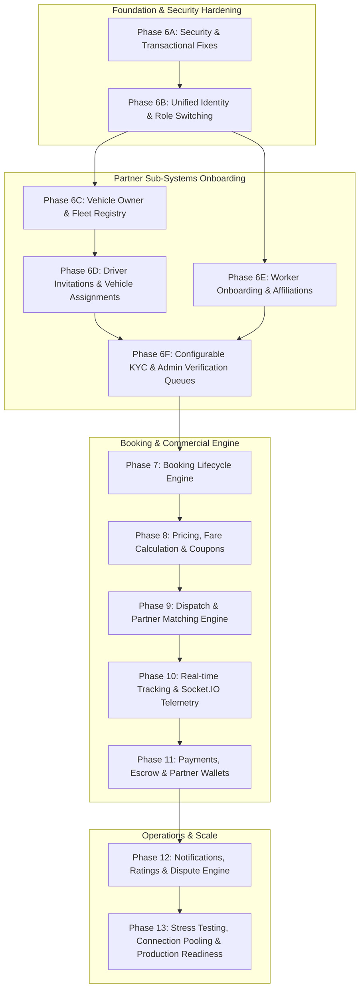

# Master Project — Final Implementation Roadmap

**Date**: November 4, 2026  
**Auditor**: Senior Backend Architect & Technical Program Manager  
**Architecture Model**: Modular Monolith on Node.js + Express + TypeScript + PostgreSQL 18 + Prisma ORM

---

## 1. Architectural Strategy & Phased Breakdown

To ensure data integrity, legal compliance, and stable multi-trade marketplace execution, implementation must follow a **strict dependency-aware order**. Fixing security and identity gaps before building transactional dispatch prevents unvetted or suspended partners from participating in customer bookings.

---

## 2. Phase-by-Phase Detailed Specifications

### Phase 6A: Security & Transactional Integrity Fixes
- **Scope**: Resolve all critical findings identified in the Phase 6 Security Audit:
  1. Mandate verified KYC documents before partner approval.
  2. Implement `requireApprovedPartner` middleware and enforce suspension blocking on partner endpoints.
  3. Wrap all administrative mutations and audit logging in atomic `prisma.$transaction`.
  4. Implement secure admin document download/stream endpoint `GET /api/v1/admin/partners/documents/:id/file`.
  5. Validate strict lifecycle transitions (prevent suspending unapproved partners).
- **Dependencies**: Completed Phase 6.
- **Existing Tables Reused**: `partner_profiles`, `partner_documents`, `audit_logs`, `user_sessions`.
- **Proposed New Tables**: None (zero schema change required; pure service/middleware/route hardening).
- **Required APIs**:
  - `GET /api/v1/admin/partners/documents/:id/file` (Admin file stream).
- **Required Tests**:
  - Approval blocked when KYC pending/rejected.
  - Approval succeeds only when all KYC verified.
  - Suspended partner blocked from partner APIs.
  - Non-approved partner cannot be suspended.
  - Atomic rollback of status if audit log insertion fails.
- **Completion Criteria**: 100% test pass rate on all Phase 6 security scenarios; zero un-transactioned admin mutations.

---

### Phase 6B: Unified Identity & Multi-Role Switching Architecture
- **Scope**: Single Partner App authentication support, context-based role switching, active role inspection.
- **Dependencies**: Phase 6A.
- **Existing Tables Reused**: `users`, `roles`, `user_roles`, `user_sessions`.
- **Proposed New Tables**: None.
- **Required APIs**:
  - `GET /api/v1/auth/active-roles` — List user's roles along with their respective approval states.
  - `POST /api/v1/auth/switch-role` — Exchange access token for a role-scoped context token (`activeRole`).
- **Required Tests**:
  - User with CUSTOMER and PARTNER roles can switch context.
  - Token scoped to CUSTOMER cannot invoke PARTNER routes.
- **Completion Criteria**: Partner App can dynamically toggle between Customer, Partner, Driver, and Worker views without re-authenticating.

---

### Phase 6C: Vehicle Owner & Fleet Management
- **Scope**: Vehicle registration, commercial RC/fitness/insurance metadata, fleet owner management.
- **Dependencies**: Phase 6B.
- **Existing Tables Reused**: `vehicle_types`, `vehicles`, `partner_vehicles`, `partner_profiles`.
- **Proposed Schema Modifications**:
  - Add `owner_partner_id BIGINT REFERENCES partner_profiles(id)` on `vehicles`.
  - Add `vehicle_documents` table (`vehicle_id`, `document_type`, `storage_key`, `valid_until`, `verification_status`).
- **Required APIs**:
  - `POST /api/v1/partners/vehicles` (Register vehicle into owner fleet).
  - `GET /api/v1/partners/vehicles` (List owner's fleet).
  - `GET /api/v1/partners/vehicles/:id` (Get vehicle detail and active driver).
  - `POST /api/v1/partners/vehicles/:id/documents` (Upload RC, fitness, insurance).
  - `GET /api/v1/partners/vehicles/:id/documents` (List vehicle documents).
- **Required Tests**:
  - Owner registers multiple vehicles.
  - Vehicle uniqueness enforced on `registration_number`.
  - Unverified vehicles cannot be dispatched.
- **Completion Criteria**: Complete fleet registry operational with independent document upload and verification tracking.

---

### Phase 6D: Driver Invitations & Vehicle Assignment Lifecycle
- **Scope**: Vehicle owner invites driver by mobile number; driver accepts in Partner App; owner assigns driver to vehicle; 1-vehicle-to-1-driver active constraint.
- **Dependencies**: Phase 6C.
- **Existing Tables Reused**: `vehicles`, `users`, `roles` (`DRIVER`), `partner_profiles`.
- **Proposed New Tables**:
  - `driver_profiles` (`user_id`, `license_number`, `license_valid_until`, `approval_status`).
  - `driver_invitations` (`owner_partner_id`, `vehicle_id`, `driver_mobile_number`, `invitation_token`, `status`).
  - `vehicle_driver_assignments` (`vehicle_id`, `driver_user_id`, `assigned_by_partner_id`, `assignment_status`, `started_at`, `ended_at`).
  - Partial unique index: `uq_active_vehicle_driver ON vehicle_driver_assignments(vehicle_id) WHERE assignment_status = 'ACTIVE'`.
- **Required APIs**:
  - `POST /api/v1/partners/drivers/invite` (Owner sends invite).
  - `GET /api/v1/partners/drivers/invitations` (Owner lists invites).
  - `GET /api/v1/drivers/invitations/pending` (Driver lists pending invites).
  - `POST /api/v1/drivers/invitations/:id/accept` (Driver accepts invite).
  - `POST /api/v1/drivers/invitations/:id/reject` (Driver declines invite).
  - `POST /api/v1/partners/vehicles/:id/assign-driver` (Assign driver to vehicle).
  - `POST /api/v1/partners/vehicles/:id/unassign-driver` (Unassign active driver).
  - `GET /api/v1/partners/vehicles/:id/driver-history` (Historical driver assignments).
- **Required Tests**:
  - Invitation sent, received, and accepted.
  - Driver can only be assigned to one vehicle at a time.
  - Second driver assignment to same active vehicle fails with conflict error.
  - Assignment history is preserved with timestamps.
- **Completion Criteria**: Safe driver delegation operational with zero driver-collision risk.

---

### Phase 6E: Worker Onboarding & Partner Affiliations
- **Scope**: Independent loading/unloading worker registration, multi-partner affiliation requests and acceptance, independent dispatch eligibility toggle.
- **Dependencies**: Phase 6B.
- **Existing Tables Reused**: `users`, `roles` (`WORKER`), `partner_profiles`.
- **Proposed New Tables**:
  - `worker_profiles` (`user_id`, `is_independent_eligible`, `max_lifting_weight_kg`, `approval_status`).
  - `worker_affiliations` (`worker_user_id`, `partner_id`, `status: ['PENDING', 'ACCEPTED', 'REJECTED', 'TERMINATED']`, `initiated_by`).
- **Required APIs**:
  - `POST /api/v1/workers/profile` (Worker onboarding).
  - `GET /api/v1/workers/profile` (Worker profile).
  - `PATCH /api/v1/workers/availability` (Toggle independent duty status).
  - `POST /api/v1/workers/affiliations/request` (Send affiliation request).
  - `GET /api/v1/workers/affiliations` (List affiliations).
  - `PATCH /api/v1/workers/affiliations/:id/accept` (Accept affiliation).
  - `PATCH /api/v1/workers/affiliations/:id/terminate` (Terminate affiliation).
- **Required Tests**:
  - Worker onboards independently.
  - Worker affiliates with multiple vehicle partners simultaneously.
  - Un-affiliated workers remain available for direct customer loading bookings.
- **Completion Criteria**: Flexible worker labor pool established with dual-mode operational support.

---

### Phase 6F: Configurable KYC & Admin Verification Queues
- **Scope**: Role-based KYC rules engine (`kyc_document_types`, `kyc_requirement_rules`), granular admin review queues for vehicles, drivers, workers, and skills.
- **Dependencies**: Phases 6C, 6D, 6E.
- **Existing Tables Reused**: `partner_documents`, `audit_logs`, `roles`.
- **Proposed New Tables**:
  - `kyc_document_types` (`type_code`, `type_name`, `requires_expiry_date`, `is_active`).
  - `kyc_requirement_rules` (`role_name`, `profile_type`, `document_type_id`, `is_mandatory`).
  - `permissions` & `role_permissions` (Granular RBAC).
- **Required APIs**:
  - `GET /api/v1/admin/vehicles/pending` (Vehicle approval queue).
  - `PATCH /api/v1/admin/vehicles/:id/approve` / `reject`.
  - `GET /api/v1/admin/drivers/pending` (Driver approval queue).
  - `PATCH /api/v1/admin/drivers/:id/approve` / `reject`.
  - `GET /api/v1/admin/workers/pending` (Worker approval queue).
  - `PATCH /api/v1/admin/workers/:id/approve` / `reject`.
  - `GET /api/v1/admin/kyc-rules` (Inspect KYC configuration).
- **Required Tests**:
  - Adding a new mandatory KYC document rule dynamically blocks unverified partner approval without code changes.
  - Driver license verification updates driver status to `APPROVED`.
- **Completion Criteria**: Configurable compliance and governance system ready for all platform roles.

---

### Phase 7: Booking Lifecycle Engine
- **Scope**: Home Services and Home/Office Shifting booking state machines, inventory items, labor details, scheduling, address attachment.
- **Dependencies**: Phases 6A–6F.
- **Existing Tables Reused**: `bookings`, `booking_items`, `booking_inventory_items`, `booking_labor_details`, `booking_status_history`, `user_addresses`.
- **Required APIs**:
  - `POST /api/v1/bookings/home-services` (Create home service booking).
  - `POST /api/v1/bookings/shifting` (Create home/office shifting booking).
  - `GET /api/v1/bookings/:id` (Booking details).
  - `PATCH /api/v1/bookings/:id/cancel` (Customer/Admin cancellation).
- **Completion Criteria**: End-to-end booking state machine transitions with immutable status history.

---

### Phase 8: Pricing, Fare Calculation & Coupons
- **Scope**: Dynamic fare breakdowns (base, km, min, labor, floors, surge, tax), city rate cards, coupon redemption.
- **Dependencies**: Phase 7.
- **Existing Tables Reused**: `fare_breakdowns`, `service_rate_cards`, `pricing_rules`, `coupons`, `vehicle_types`.
- **Required APIs**:
  - `POST /api/v1/pricing/estimate` (Get fare estimate for shifting or home services).
  - `POST /api/v1/coupons/apply` (Validate coupon code).
- **Completion Criteria**: Accurate, deterministic fare calculation with tax and discount audit trails.

---

### Phase 9: Dispatch & Partner Matching Engine
- **Scope**: Redis GEO nearby partner discovery, skill filtering, vehicle matching, broadcast offers, atomic acceptance.
- **Dependencies**: Phase 8.
- **Existing Tables Reused**: `booking_assignments`, `partner_availability`, `partner_service_areas`, `partner_skills`.
- **Completion Criteria**: Concurrent assignment conflict prevention with atomic check-and-set locks.

---

### Phase 10: Real-time Telemetry & Live Tracking
- **Scope**: Socket.IO integration, live GPS breadcrumb streaming, trip status broadcasts.
- **Dependencies**: Phase 9.
- **Existing Tables Reused**: `partner_live_locations`, `partner_location_history`.
- **Completion Criteria**: Sub-second GPS streaming with low battery consumption and historical playback.

---

### Phase 11: Payments, Escrow & Partner Wallets
- **Scope**: Gateway integration (Razorpay/Stripe), payment capture, refunds, partner wallet ledger, automated payouts.
- **Dependencies**: Phase 10.
- **Existing Tables Reused**: `payments`, `refunds`, `partner_wallets`, `wallet_transactions`.
- **Completion Criteria**: Double-entry financial consistency with idempotency protection.

---

### Phase 12: Notifications, Ratings & Dispute Engine
- **Scope**: Push/SMS/In-app notification triggers, bidirectional ratings, reviews, dispute tickets.
- **Dependencies**: Phase 11.
- **Existing Tables Reused**: `notifications`, `reviews_ratings`.
- **Completion Criteria**: Automated customer engagement and resolution workflow.

---

### Phase 13: Stress Testing & Production Readiness
- **Scope**: k6 load testing for 100k+ users, PostgreSQL connection pooling optimization, Redis caching of taxonomy, Docker containerization.
- **Dependencies**: All prior phases.
- **Completion Criteria**: Sub-100ms p95 latency under 5,000 concurrent requests; zero database connection drops.

