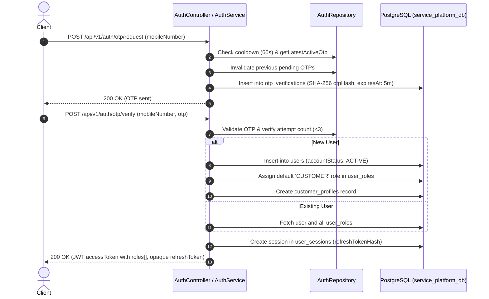
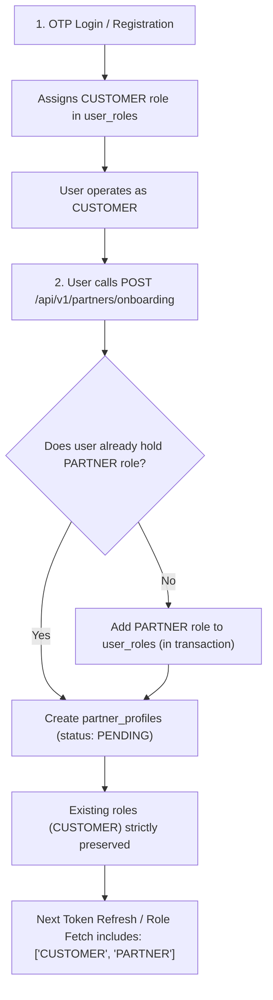
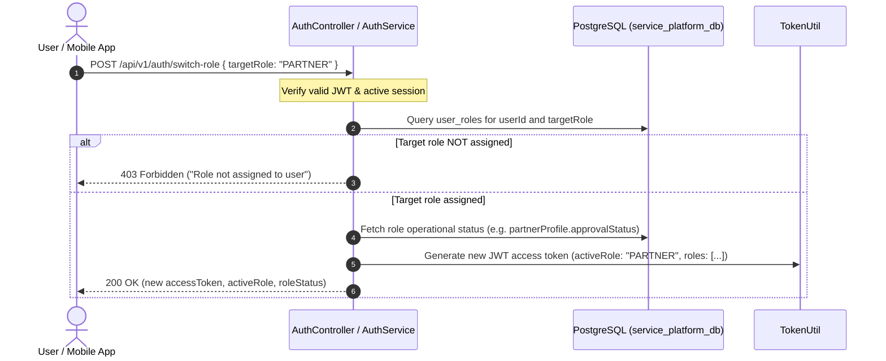
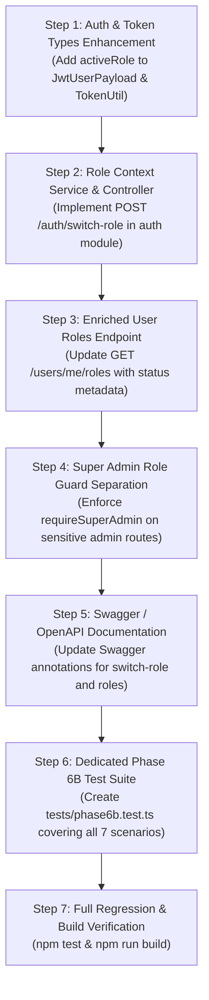

# Phase 6B: Unified Identity & Role Management
## Architecture Inspection & Implementation Plan

**Project:** Multi-Service Marketplace Backend  
**Directory:** `C:\Users\baps\Desktop\Backend`  
**Database:** `service_platform_db` (PostgreSQL 18, Prisma ORM)  
**Date:** November 4, 2026  
**Status:** Read-Only Inspection Complete — Awaiting Implementation Authorization  

---

## 1. Current Architecture Findings

A thorough read-only audit of the existing identity, authentication, role assignment, and session management architecture was conducted across the database schema, Prisma models, middleware layers, and services.

### A. Identity & Storage Schema
1. **User Identity (`users` table):**
   - Single source of truth for physical identity.
   - Unique constraint on `mobile_number` (`uq_users_mobile_number`) guarantees **one mobile number = one user account**.
   - Fields: `id` (bigint), `mobile_number`, `email` (nullable, unique), `account_status` (`ACTIVE`, `BLOCKED`, `DELETED`), `is_mobile_verified` (boolean), timestamps.
2. **Roles Schema (`roles` table):**
   - Pre-seeded with 6 distinct business and system roles:
     - `CUSTOMER` (ID: 1) — User who books services.
     - `PARTNER` (ID: 2) — Service provider offering professional services.
     - `DRIVER` (ID: 3) — Fleet operator / vehicle driver.
     - `WORKER` (ID: 4) — Laborer performing loading, unloading, and physical tasks.
     - `ADMIN` (ID: 5) — Operational platform administrator.
     - `SUPER_ADMIN` (ID: 6) — Platform super administrator.
3. **User Roles Relationship (`user_roles` table):**
   - Connects `users.id` to `roles.id`.
   - Governed by composite unique constraint: `@@unique([userId, roleId], map: "uq_user_role")`.
   - **Guarantees that existing roles can never be duplicated** for a given user.
4. **Session Storage (`user_sessions` table):**
   - Manages active client devices and refresh tokens.
   - Stores `refresh_token_hash` (SHA-256), `expires_at`, `revoked_at`, `last_used_at`, device metadata, and IP address.
   - Connected directly to `users.id` with `onDelete: Cascade`.

### B. Current Token Model
- **Access Token:** Stateless JWT signed with `JWT_ACCESS_SECRET`.
  - Expiry: 15 minutes (`ACCESS_TOKEN_EXPIRY`).
  - Payload definition (`src/modules/auth/auth.types.ts`):
    ```typescript
    export interface JwtUserPayload {
      userId: string;
      mobileNumber: string;
      roles: string[]; // Array of all assigned role names, e.g. ['CUSTOMER', 'PARTNER']
      sessionId: string;
    }
    ```
- **Refresh Token:** Cryptographically secure 64-character hex string stored as SHA-256 hash in `user_sessions`.
  - Expiry: 30 days (`REFRESH_TOKEN_EXPIRY`).
  - Strict refresh token rotation and token reuse breach detection are implemented.

---

## 2. Existing Authentication Flow



1. **OTP Verification:**
   - Authenticates mobile possession.
   - New users are registered and automatically granted the `CUSTOMER` role.
   - Existing users are loaded with all their assigned roles from `user_roles`.
2. **Session & Token Issuance:**
   - An access token containing `userId`, `mobileNumber`, `sessionId`, and `roles: string[]` is minted.
   - An opaque refresh token is generated, hashed, and stored in `user_sessions`.
3. **Session Verification (`requireAuth` Middleware):**
   - Verifies JWT signature and expiry.
   - Validates that the underlying session ID exists in `user_sessions` and has not been revoked (`revokedAt === null`).

---

## 3. Existing Role Assignment Flow



- When a customer decides to become a partner, driver, or worker:
  1. The user invokes the respective onboarding endpoint (e.g., `POST /api/v1/partners/onboarding`).
  2. In an atomic transaction, the system checks whether the target role is already linked in `user_roles`.
  3. If not linked, a new record is created in `user_roles`.
  4. The profile record (e.g., `partner_profiles`) is created in `PENDING` status.
  5. The user's original account, user ID, customer profile, and customer history remain completely intact.

---

## 4. Current Authorization Weaknesses & Gaps

While the database design and Phase 6A remediations are sound, inspection revealed four architectural gaps in identity and role context handling:

1. **Absence of an Explicit "Active Role Context":**
   - The JWT payload currently contains `roles: string[]` (e.g. `['CUSTOMER', 'PARTNER']`).
   - There is no field indicating which role the user is **actively operating in**.
   - As a consequence, a user with both roles can theoretically execute customer calls and partner calls concurrently with the same token. While safe, this prevents client-facing role context segmentation (e.g., displaying partner dashboard vs customer booking history).
2. **No Role Switching Endpoint:**
   - There is no dedicated API (`POST /api/v1/auth/switch-role`) allowing a mobile app or frontend to explicitly switch into "Partner Mode", "Driver Mode", or "Customer Mode".
   - The user must currently rely on ambient permissions granted by holding the role in `req.user.roles`.
3. **Coarse-Grained Admin Authorization:**
   - Both `ADMIN` and `SUPER_ADMIN` are accepted by `requireAdmin`.
   - There is no protection preventing an operational `ADMIN` from invoking super-admin endpoints (such as assigning/revoking admin privileges or purging audit logs).
4. **Lack of Role Status Introspection in Role Queries:**
   - `GET /api/v1/users/me/roles` returns only `{ roleName, description, assignedAt }`.
   - It does not inform the client whether that role is currently operational, pending approval, or suspended.
   - The client application has to independently query `/partners/profile` or `/customers/profile` to determine if a role is ready for operational use.

---

## 5. Proposed Role-Context Architecture

### A. Core Architectural Principles
1. **Single Identity:** One `users` row per mobile number. Never create duplicate user accounts.
2. **Multi-Role Membership:** A user holds 1 to N roles in `user_roles`. Adding a role preserves all existing roles.
3. **Active Role Context:**
   - An authenticated session has one primary **`activeRole`** context.
   - The `activeRole` represents the current operational perspective (e.g., acting as `CUSTOMER` vs acting as `PARTNER`).
   - The `activeRole` is cryptographically signed inside the JWT access token:
     ```typescript
     export interface JwtUserPayload {
       userId: string;
       mobileNumber: string;
       roles: string[];      // All roles assigned to user
       activeRole: string;   // Current active operating context
       sessionId: string;
     }
     ```
4. **Authorization Independence:**
   - Backend domain endpoints enforce operational verification **regardless of the active role**.
   - Switching `activeRole` to `PARTNER` does **not** bypass `partner_profiles.approvalStatus`.
   - A suspended partner whose `activeRole` is `PARTNER` is still rejected with HTTP 403 on operational partner endpoints.
   - Switching `activeRole` to `CUSTOMER` immediately restores full customer functionality even if their partner profile is suspended.

### B. Role Switching Flow



---

## 6. Proposed API Endpoints & Request/Response Contracts

### A. `POST /api/v1/auth/switch-role`
Allows an authenticated user to switch their operational context to any role they hold.

- **Security:** `requireAuth`
- **Request Body:**
  ```json
  {
    "role": "PARTNER"
  }
  ```
- **Validation Rules:**
  - `role` must be a valid enum: `CUSTOMER`, `PARTNER`, `DRIVER`, `WORKER`, `ADMIN`, `SUPER_ADMIN`.
  - User must hold the role in `user_roles`.
- **Response (200 OK):**
  ```json
  {
    "success": true,
    "message": "Switched to PARTNER context successfully.",
    "data": {
      "activeRole": "PARTNER",
      "availableRoles": ["CUSTOMER", "PARTNER"],
      "roleStatus": {
        "role": "PARTNER",
        "approvalStatus": "APPROVED",
        "isOperational": true
      },
      "tokens": {
        "accessToken": "eyJhbGciOiJIUzI1NiIsInR5cCI6IkpXVCJ9...",
        "tokenType": "Bearer",
        "expiresIn": "15m"
      }
    }
  }
  ```
- **Error Responses:**
  - `400 Bad Request`: Invalid role name or malformed request.
  - `403 Forbidden`: `Access forbidden: Role 'DRIVER' is not assigned to this account.`

### B. Enhanced `GET /api/v1/auth/me`
Updated to reflect the active role and comprehensive identity state.

- **Response (200 OK):**
  ```json
  {
    "success": true,
    "data": {
      "id": "15",
      "mobileNumber": "+919999111003",
      "email": "partner@example.com",
      "accountStatus": "ACTIVE",
      "isMobileVerified": true,
      "activeRole": "PARTNER",
      "roles": ["CUSTOMER", "PARTNER"],
      "createdAt": "2026-11-04T08:00:00.000Z"
    }
  }
  ```

### C. Enhanced `GET /api/v1/users/me/roles`
Returns assigned roles enriched with domain status information.

- **Response (200 OK):**
  ```json
  {
    "success": true,
    "data": {
      "activeRole": "CUSTOMER",
      "roles": [
        {
          "roleName": "CUSTOMER",
          "description": "User who books services",
          "assignedAt": "2026-11-04T08:00:00.000Z",
          "status": "ACTIVE",
          "isOperational": true
        },
        {
          "roleName": "PARTNER",
          "description": "User who provides professional services",
          "assignedAt": "2026-11-04T08:15:00.000Z",
          "status": "APPROVED",
          "isOperational": true
        }
      ]
    }
  }
  ```

### D. Protected Admin Endpoints for Role Management
1. **`POST /api/v1/admin/users/:id/roles` (Super Admin Only):**
   - Grants privileged roles (`ADMIN`, `SUPER_ADMIN`, `DRIVER`, `WORKER`).
   - Guarded by `requireSuperAdmin`.
2. **`DELETE /api/v1/admin/users/:id/roles/:roleName` (Super Admin Only):**
   - Revokes assigned roles.
   - Prohibits revoking the user's last remaining role.
   - Prohibits self-revocation of `SUPER_ADMIN`.

---

## 7. Answers to Critical Design Questions

| Question | Investigation Finding & Proposed Architectural Resolution |
|---|---|
| **Does current JWT represent all roles or one active role?** | Current JWT represents `roles: string[]` (all roles). Proposed design updates `JwtUserPayload` to include **both**: `roles: string[]` (all assigned) and `activeRole: string` (current context). |
| **How does backend determine role context?** | Currently: Ambiently by checking if the required role is present in `roles[]`. Target: Endpoints will check `req.user.activeRole` when context-specific behavior is required, while `requireRole` continues to verify entitlement. |
| **Can multiple roles be safely activated without duplicate identities?** | Yes. `users` holds the identity; `user_roles` holds the associations. Multiple roles activate profiles (`customer_profiles`, `partner_profiles`) tied to the same `user_id`. |
| **Is an explicit switch-role endpoint required?** | Yes. `POST /api/v1/auth/switch-role` provides a clear, auditable transition that validates role membership and returns a signed token with the new `activeRole`. |
| **Should switching roles issue a new access token?** | Yes. Minting a new JWT access token with the updated `activeRole` ensures stateless, tamper-proof context propagation without database writes per request. |
| **How should approval status affect role switching?** | Switching to a role context is permitted if the role is assigned (allowing viewing onboarding status or suspension notices). However, operational actions remain gated by domain status middlewares (`requireApprovedPartner`). |
| **How do revoked/suspended roles behave during token refresh?** | In `POST /api/v1/auth/refresh`, fresh roles are loaded from PostgreSQL. If an active role was revoked, the token falls back to `CUSTOMER`. If a partner is suspended, token refresh succeeds for `CUSTOMER`, but partner operational actions remain blocked. |
| **How can ADMIN and SUPER_ADMIN be separated?** | Split `requireAdmin` into: `requireAdmin` (for operational reviews, KYC verifications) and `requireSuperAdmin` (for role grants, system configuration, admin suspensions). |
| **Can existing schema support design without migrations?** | **Yes, 100%.** Zero schema changes or migrations are needed. `users`, `roles`, `user_roles`, and `user_sessions` already have all required columns and constraints. |

---

## 8. Database Migration Requirement

* **Required PostgreSQL Migrations:** **`0` (Zero)**
* **Required Prisma Schema Changes:** **`0` (Zero)**

The PostgreSQL schema established in Migrations 001–011 already provides:
1. `users`: Stores core identity.
2. `roles`: Pre-seeded with all 6 required roles (`CUSTOMER`, `PARTNER`, `DRIVER`, `WORKER`, `ADMIN`, `SUPER_ADMIN`).
3. `user_roles`: Manages many-to-many relationship with `(user_id, role_id)` unique constraint.
4. `user_sessions`: Manages session validity.

---

## 9. Security & Privilege Escalation Defenses

1. **Self-Promotion Prevention:**
   - Normal users cannot assign roles to themselves via API.
   - Users can only acquire `PARTNER` through the validated onboarding flow.
   - Privileged roles (`ADMIN`, `SUPER_ADMIN`) can only be assigned by an authenticated `SUPER_ADMIN` via atomic audit-logged endpoints.
2. **Context Tampering Prevention:**
   - `activeRole` is signed inside the JWT HMAC payload. Clients cannot modify `activeRole` without invalidating the token signature.
3. **Defense-in-Depth Authorization:**
   - Context check (`req.user.activeRole === 'PARTNER'`) is backed by role entitlement check (`req.user.roles.includes('PARTNER')`) AND database lifecycle check (`partnerProfile.approvalStatus === 'APPROVED'`).
4. **Session Independence on Suspension:**
   - Partner suspension never invalidates the user's `CUSTOMER` session or marks `users.account_status = 'BLOCKED'`.
   - Dual-role users can immediately switch to `CUSTOMER` and book services normally.

---

## 10. Required Test Scenarios for Phase 6B

A dedicated test suite `tests/phase6b.test.ts` will verify:

1. **Unified Identity & Role Assignment:**
   - First-time user gets `CUSTOMER` role automatically.
   - Submitting partner onboarding assigns `PARTNER` role while preserving `CUSTOMER` role.
   - Attempting to re-assign an existing role is idempotent and does not create duplicate `user_roles`.
2. **Role Switching Mechanics (`POST /api/v1/auth/switch-role`):**
   - Successfully switch from `CUSTOMER` to `PARTNER` context and receive signed token.
   - Successfully switch back from `PARTNER` to `CUSTOMER` context.
   - Reject switching to an unassigned role (e.g. `ADMIN` or `DRIVER`) with HTTP 403.
   - Reject switching with invalid/unknown role name with HTTP 400.
   - Unauthenticated switch attempt rejected with HTTP 401.
3. **Role Context Operational Enforcement:**
   - When in `CUSTOMER` context, calling partner operational endpoints checks entitlement or enforces context.
   - When in `PARTNER` context, calling customer profile endpoints succeeds cleanly.
4. **Suspension & Context Isolation:**
   - Suspending partner profile allows user to switch to `PARTNER` in read-only mode (inspect status).
   - Suspended partner is blocked with HTTP 403 on operational partner actions.
   - User switches to `CUSTOMER` context and executes customer operations (e.g., address CRUD, customer profile) with HTTP 200.
5. **Token Refresh with Multi-Role Context:**
   - Refresh token rotation preserves the active role context.
   - Revoking a role in database causes the refreshed token to remove that role and fall back to `CUSTOMER`.
6. **Admin vs Super Admin Privilege Separation:**
   - Operational `ADMIN` can approve/verify partners, but receives HTTP 403 when calling `requireSuperAdmin` endpoints.
   - `SUPER_ADMIN` can access both admin and super-admin endpoints.
7. **Regression Suite:**
   - Full regression pass (`npm test`) ensuring Phase 5 Auth, Phase 6 Profile/Onboarding, and Phase 6A Security remain 100% passing.

---

## 11. Swagger / OpenAPI Documentation Updates

The following OpenAPI additions will be registered:
1. `POST /api/v1/auth/switch-role`: Documented with request schema, 200 (new access token), 400 (validation), 401 (unauthorized), and 403 (unassigned role).
2. `GET /api/v1/users/me/roles`: Documented with enriched response schema including status and operational readiness per role.
3. Updated JWT Security Scheme documentation explaining the `activeRole` payload claim.

---

## 12. Proposed Implementation Sequence



---

## 13. Backward Compatibility & Rollback Plan

- **Backward Compatibility:**
  - `activeRole` is additive to the JWT payload. Existing clients inspecting `req.user.roles` or `req.user.userId` continue to work without breaking changes.
  - If a token without `activeRole` is received (e.g. from an existing pre-Phase 6B session), middleware defaults `activeRole` to `roles[0]` (typically `CUSTOMER`).
  - No database schema alterations are introduced.
- **Rollback Plan:**
  - Because no database migrations or schema modifications are performed, rollback is 100% code-level: reverting the Git commits restores the exact Phase 6A state with zero data loss or migration reversal.

---

*(Inspection complete. Zero code or database modifications have been made. Standing by for your review and explicit implementation authorization.)*

