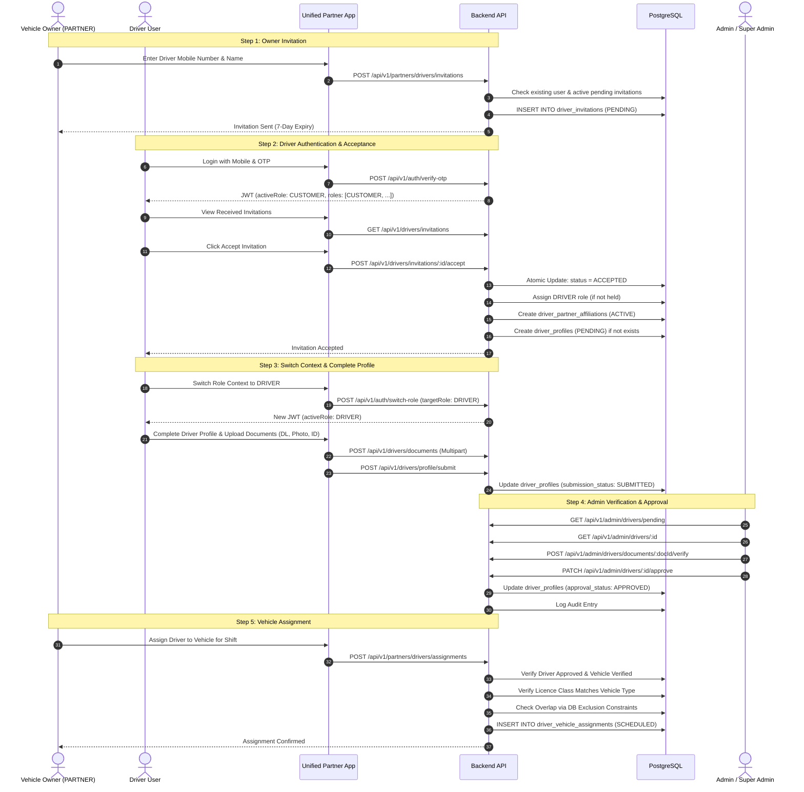
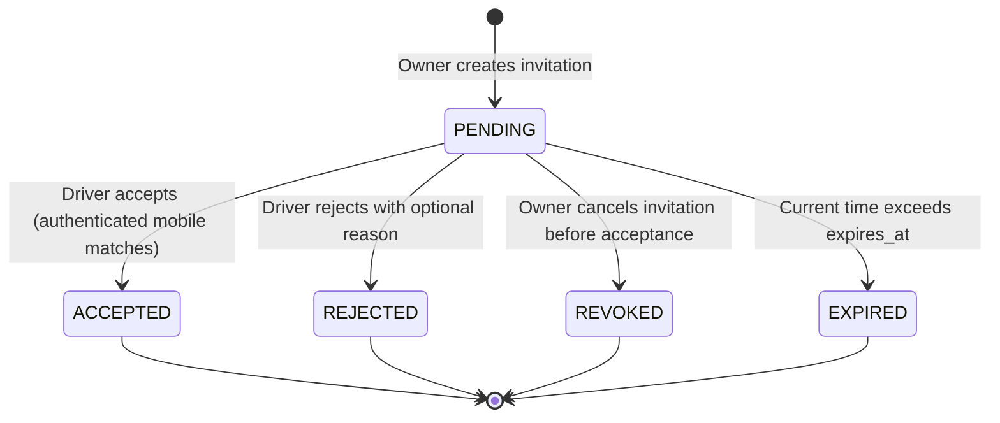
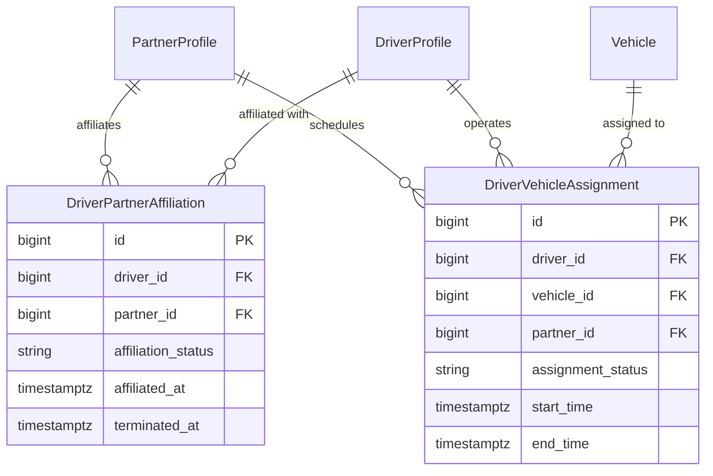
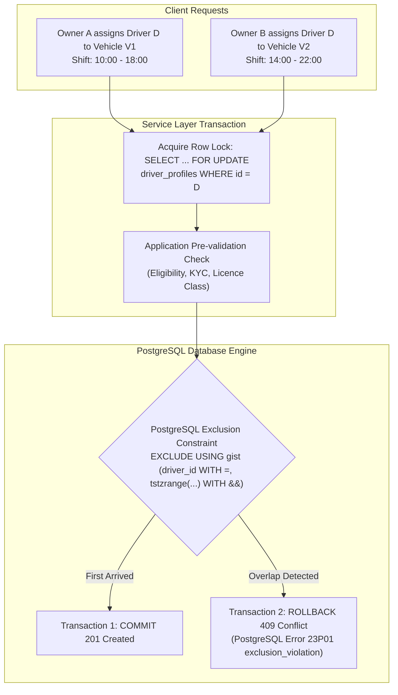
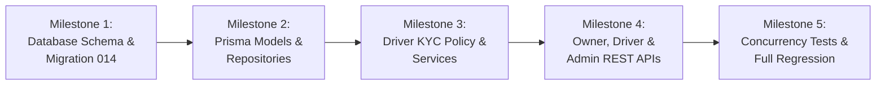

# Phase 6D — Driver Management & Assignment
## Architecture Inspection & Implementation Plan

**Date:** 2026-11-05  
**Project:** Multi-Service Marketplace Backend  
**Directory:** `C:\Users\baps\Desktop\Backend`  
**Stack:** Node.js, Express, TypeScript, PostgreSQL 18, Prisma ORM, Redis, Jest  
**Execution Mode:** STRICT READ-ONLY Architecture Inspection & Planning  
**Status:** Architecture Inspection Completed — Awaiting Implementation Authorization  

---

## 1. Executive Summary & Objective

In our asset-light, multi-city service marketplace, vehicle partners own or are legally authorized to operate their vehicles. To scale operations, vehicle owners can invite qualified drivers to operate vehicles in their fleet.

Drivers do not have a separate "Driver App"; they use the unified **Partner App** (shared by vehicle owners, workers, and professional service providers). This ensures a cohesive mobile application experience while strictly enforcing role-based boundaries on the backend.

### Core Business Principles
1. **Unified Identity (1 Mobile Number = 1 User Account):** Drivers, vehicle owners, workers, and customers share a single user account per mobile number.
2. **Preservation of Existing Roles:** Onboarding as a driver assigns the `DRIVER` role while preserving all existing assigned roles (`CUSTOMER`, `PARTNER`, etc.).
3. **Role Context Switching:** Users switch to the `DRIVER` role context using the Phase 6B JWT active-role architecture.
4. **Decoupled Role vs. Operational Authorization:** Holding the `DRIVER` role grants access to driver onboarding and profile management, but **never** grants operational permissions until independent administrative approval is granted.
5. **Multi-Owner Driver Affiliation:** A driver can be affiliated with multiple vehicle owners (e.g. morning shift with Owner A, evening shift with Owner B, or freelance).
6. **Dynamic Vehicle Shifts:** A driver may operate multiple vehicles across different non-overlapping shifts. Multiple drivers can operate the same vehicle across different shifts.
7. **Database-Enforced Non-Overlapping Assignments:** Neither a driver nor a vehicle can have overlapping operational assignments. Concurrency and schedule collisions must be blocked at the database level.
8. **Independent Driver Verification & KYC:** Vehicle owners cannot approve their own drivers. Platform administrators independently verify driving licences, identity proofs, and operational eligibility using a fail-closed, policy-based KYC framework with Asia/Kolkata calendar-day expiry semantics.

---

## 2. Existing Architecture Findings (Inspection Facts)

A thorough, read-only inspection of the codebase was conducted. The specific findings are documented below:

### 2.1 Identity, Authentication & Role Switching
- **Table `users` ([schema.prisma](file:///C:/Users/baps/Desktop/Backend/prisma/schema.prisma#L14-L41)):** Contains `mobile_number` (unique), `account_status`, `is_mobile_verified`.
- **Table `roles` ([schema.prisma](file:///C:/Users/baps/Desktop/Backend/prisma/schema.prisma#L43-L52)):** Seeded with 6 system roles: `CUSTOMER`, `PARTNER`, `DRIVER`, `WORKER`, `ADMIN`, `SUPER_ADMIN`.
- **Table `user_roles` ([schema.prisma](file:///C:/Users/baps/Desktop/Backend/prisma/schema.prisma#L54-L65)):** Enforces unique `(user_id, role_id)`.
- **JWT Active Role System ([src/common/middlewares/auth.middleware.ts](file:///C:/Users/baps/Desktop/Backend/src/common/middlewares/auth.middleware.ts#L102-L143)):**
  - Middleware `requireActiveRole(UserRole.DRIVER)` validates both entitlement (user holds `DRIVER` in `roles[]`) and active context (`activeRole === 'DRIVER'`).
  - Shorthand middleware: `requireAuth`, `requireRole`, `requireAdmin`, `requireSuperAdmin`.
- **Existing Role Operational Status Stub ([src/modules/auth/auth.service.ts](file:///C:/Users/baps/Desktop/Backend/src/modules/auth/auth.service.ts#L417-L420) & [src/modules/users/users.service.ts](file:///C:/Users/baps/Desktop/Backend/src/modules/users/users.service.ts#L119-L122)):**
  Currently, `DRIVER` returns stubbed status:
  ```typescript
  } else if (roleName === UserRole.DRIVER || roleName === UserRole.WORKER) {
    approvalStatus = 'NOT_ONBOARDED';
    isOperational = false;
  }
  ```
  *Fact:* There is currently no `DriverProfile` model or database table in `prisma/schema.prisma`.

### 2.2 Vehicle Fleet Architecture (Phase 6C Baseline)
- **Table `vehicles` ([schema.prisma](file:///C:/Users/baps/Desktop/Backend/prisma/schema.prisma#L329-L353)):**
  - Fields: `registration_number`, `vehicle_type_id`, `verification_status` (`PENDING`, `VERIFIED`, `REJECTED`, `SUSPENDED`), `is_active`.
- **Table `partner_vehicles` ([schema.prisma](file:///C:/Users/baps/Desktop/Backend/prisma/schema.prisma#L355-L372)):**
  - Manages partner ownership and operating authority: `ownership_type` (`OWNER`, `LEASED`, `AUTHORIZED_REPRESENTATIVE`), `ownership_status` (`ACTIVE`, `TRANSFERRED`, `INACTIVE`), `assigned_at`, `unassigned_at`, `is_primary`.
  - Enforced by partial unique index `idx_one_primary_vehicle_per_partner` and check constraint `chk_active_ownership_unassigned_at` (applied in Migration 013).
- **Table `vehicle_documents` ([schema.prisma](file:///C:/Users/baps/Desktop/Backend/prisma/schema.prisma#L374-L392)):**
  - Historical document tracking with non-cascade deletion and administrative verification.
- **Vehicle KYC Policy Service ([src/modules/vehicles/services/vehicle-kyc.service.ts](file:///C:/Users/baps/Desktop/Backend/src/modules/vehicles/services/vehicle-kyc.service.ts)):**
  - Implements `IVehicleKycPolicyProvider` with fail-closed security.
  - Integrates with `DateUtil` for strict Asia/Kolkata calendar-day expiry (15-day warning, 0-day grace).
- **Booking Assignments Table Distinction ([schema.prisma](file:///C:/Users/baps/Desktop/Backend/prisma/schema.prisma#L633-L649)):**
  - `booking_assignments` in migration `007_bookings_assignments.sql` tracks booking dispatch to partner profiles (`partner_id`).
  - *Fact:* There is currently no table or relationship linking drivers to vehicles or vehicle shifts.

### 2.3 Storage, Dates, and Infrastructure
- **Secure File Storage ([src/common/services/storage.service.ts](file:///C:/Users/baps/Desktop/Backend/src/common/services/storage.service.ts)):**
  - Abstract storage interface `IStorageService` supporting file upload, retrieval, and administrative secure document streaming.
- **Date & Timezone Utilities ([src/common/utils/date.util.ts](file:///C:/Users/baps/Desktop/Backend/src/common/utils/date.util.ts)):**
  - Standardized on `Asia/Kolkata` (IST, UTC+05:30).
  - Evaluates calendar dates through 23:59:59.999 IST and expires at 00:00:00.000 IST next day.
  - Host-timezone independent using `Intl.DateTimeFormat`.
- **Audit Logging ([schema.prisma](file:///C:/Users/baps/Desktop/Backend/prisma/schema.prisma#L844-L861)):**
  - Table `audit_logs` records `actor_user_id`, `action`, `entity_name`, `entity_id`, `old_values`, `new_values`, `ip_address`, `user_agent`.
- **Database & Migrations Tracking:**
  - 13 migrations registered in `public.schema_migrations`.
  - PostgreSQL 18 with 42 platform tables.

---

## 3. Reusable Platform Capabilities

We can directly leverage the following hardened architectural assets without rewriting or reinventing them:
1. **OTP Verification Engine:** `OtpUtil`, `AuthService.requestOtp`, and `AuthService.verifyOtp` seamlessly handle authentication for drivers using their existing mobile numbers.
2. **Session & Token Management:** `TokenUtil` generates access tokens with `roles[]` and `activeRole`. Refresh token rotation and breach detection are already fully operational.
3. **Role Context Guard:** `requireActiveRole(UserRole.DRIVER)` provides instant context isolation for driver-specific routes.
4. **Partner Context Guard:** `requireActiveRole(UserRole.PARTNER)` and `requireApprovedPartner` protect owner fleet management endpoints.
5. **Policy-Based KYC Pattern:** The fail-closed architecture established in `IVehicleKycPolicyProvider` can be mirrored for driver KYC (`IDriverKycPolicyProvider`).
6. **DateUtil Calendar Semantics:** Exact Asia/Kolkata expiry calculations (0-day grace, 15-day warning) apply directly to driving licences and identity documents.
7. **Audit Log Integration:** Atomic audit logging within PostgreSQL `$transaction` blocks.

---

## 4. Missing Components & Architecture Gaps

The following architectural components must be designed and introduced in Phase 6D:
1. **Driver Profile (`driver_profiles`):** Model to store driver biographical details, driving licence metadata, administrative approval status, and operational readiness.
2. **Driver Document Management (`driver_documents`):** Dedicated table for driver KYC documents (Driving Licence, Identity Proof, Profile Photo, Commercial Badges) with historical preservation and audit review links.
3. **Driver Invitation Engine (`driver_invitations`):** Secure invitation lifecycle (`PENDING`, `ACCEPTED`, `REJECTED`, `EXPIRED`, `REVOKED`) linking vehicle owners and invited drivers.
4. **Driver-Partner Affiliation Model (`driver_partner_affiliations`):** Explicit M:N relationship tracking which drivers are authorized to drive for which vehicle owners, independent of vehicle assignments.
5. **Driver-Vehicle Assignment Engine (`driver_vehicle_assignments`):** Dedicated table managing driver shifts and assignments to specific vehicles with database-level non-overlapping constraint enforcement.
6. **Driver Availability & Shift Tracking (`driver_availability`):** Real-time online/busy status and active shift tracking for drivers.
7. **Driving Licence Verification & Class Matching:** Matrix matching driving licence vehicle classes (e.g., `LMV`, `HMV`, `MCWG`, `TRANS`) with platform vehicle types (Two-Wheeler, Three-Wheeler, Tata Ace, Pickup, Canter).
8. **Operational Status Resolution Update:** Updating `AuthService.getRoleOperationalStatus` and `UsersService.getMyRoles` to evaluate actual `driver_profiles` approval status.

---

## 5. Driver Onboarding & Identity Workflow



### Key Identity Rules
1. **No Duplicate User Records:** If an invited mobile number already exists, the invitation links to the existing user ID. If the mobile number does not exist, the invitation is stored with the mobile number, and the user account is created upon their first OTP login.
2. **Safe Role Addition:** Accepting an invitation calls the idempotent role assignment logic. The user gains `DRIVER` while retaining `CUSTOMER`, `PARTNER`, or any other assigned roles.
3. **Independent Sessions:** The vehicle owner cannot log in as the driver or view driver personal documents. The driver logs in via their own mobile number and device session.
4. **Owner-Driver Self-Operation:** A vehicle owner who wishes to drive their own vehicle must also accept their own self-invitation or initiate driver onboarding, complete their driver profile, upload a valid driving licence, and receive independent admin verification.

---

## 6. Driver Invitation Lifecycle & Concurrency Protection

### 6.1 State Machine


### 6.2 Invitation Integrity Rules
1. **Duplicate Prevention:** An owner cannot send a new invitation to a driver if a `PENDING` invitation already exists between that partner and driver mobile.
   - *Database Enforcement:* Partial unique index:
     ```sql
     CREATE UNIQUE INDEX idx_pending_driver_invitation 
     ON public.driver_invitations (partner_id, invited_mobile) 
     WHERE invitation_status = 'PENDING';
     ```
2. **Deterministic Expiry:** Invitations default to 7 days (`NOW() + INTERVAL '7 days'`). Once expired, any accept attempt returns HTTP 400 Bad Request (`INVITATION_EXPIRED`).
3. **Resending Invitations:** If an invitation is expired or needs renewal, the owner can call `/resend`. This invalidates the previous invitation token, resets `expires_at` to +7 days, and increments `resend_count`.
4. **Ownership & Tenant Isolation:** An owner can only inspect, resend, or revoke invitations where `partner_id === req.partner.id`.
5. **Authorization to Accept:** Only the user whose verified mobile number matches `invited_mobile` (or whose user ID matches `driver_user_id`) can accept or reject the invitation.
6. **Concurrent Accept/Reject Protection:**
   To prevent race conditions where a driver accepts simultaneously from two devices or accepts while an owner revokes:
   ```sql
   UPDATE public.driver_invitations
   SET invitation_status = 'ACCEPTED',
       responded_at = CURRENT_TIMESTAMP,
       updated_at = CURRENT_TIMESTAMP
   WHERE id = $1 
     AND invitation_status = 'PENDING' 
     AND expires_at > CURRENT_TIMESTAMP
   RETURNING *;
   ```
   If 0 rows are returned, the transaction aborts with HTTP 409 Conflict or 400 Bad Request.

---

## 7. Driver KYC & Policy-Based Verification Architecture

### 7.1 Configurable Policy Provider Interface
Following the architecture of `IVehicleKycPolicyProvider` ([src/modules/vehicles/services/vehicle-kyc.service.ts](file:///C:/Users/baps/Desktop/Backend/src/modules/vehicles/services/vehicle-kyc.service.ts#L29-L41)), we define `IDriverKycPolicyProvider`:

```typescript
export interface DriverKycRule {
  requiredDocumentTypes: string[];
  optionalDocumentTypes: string[];
  requiresCommercialBadge?: boolean;
  requiresPoliceVerification?: boolean;
}

export interface IDriverKycPolicyProvider {
  getRulesForDriver(params: {
    driverId?: bigint;
    targetVehicleTypeCodes?: string[];
    cityId?: bigint;
    [key: string]: any;
  }): Promise<DriverKycRule | null | undefined>;
}
```

### 7.2 Baseline KYC Requirements
- **Mandatory Documents:**
  1. `DRIVING_LICENCE`: Valid, government-issued driving licence.
  2. `IDENTITY_PROOF`: Aadhaar Card, Passport, Voter ID, or National ID (configurable, never hardcoded).
  3. `PROFILE_PHOTO`: Clear, recent driver photograph for identity matching and booking trust.
- **Optional / Conditional Documents:**
  1. `COMMERCIAL_BADGE`: Required for commercial taxi/transport in specific regulatory jurisdictions.
  2. `POLICE_VERIFICATION`: Required for high-security or premium corporate logistics contracts.

### 7.3 Driving Licence Class Compatibility Matrix
A driver must possess a licence class appropriate for the vehicle they operate. The system validates this during vehicle assignment:

| Vehicle Type Code | Vehicle Category | Minimum Driving Licence Classes Required |
|---|---|---|
| `TWO_WHEELER` | Motorcycle / Scooter | `MCWG` (Motorcycle With Gear), `MCWOG` (Motorcycle Without Gear) |
| `THREE_WHEELER` | Auto Rickshaw / Cargo 3W | `3W-CAB`, `3W-NT`, `LMV`, `TRANS` |
| `TATA_ACE` | Small Commercial Vehicle (SCV) | `LMV` (Light Motor Vehicle), `LMV-TR`, `TRANS` |
| `PICKUP_8FT` | Light Commercial Vehicle (LCV) | `LMV`, `LMV-TR`, `TRANS` |
| `CANTER_14FT` | Medium/Heavy Commercial Vehicle | `MGV`, `HGV`, `HMV`, `TRANS` |

### 7.4 Document Expiry & Zero-Day Grace Period
Driver documents strictly follow the platform's `Asia/Kolkata` calendar policy:
- **Valid Through:** Up to `23:59:59.999 IST` on the expiry date.
- **Expired At:** `00:00:00.000 IST` the next day.
- **Grace Period:** Strictly **0 days**. Drivers with expired driving licences cannot be assigned or operate vehicles.
- **Proactive Warning:** Emitted **15 days** before expiry (`isExpiringSoon = true`).

---

## 8. Driver-Owner Affiliation Model

The platform cleanly separates **Affiliation** from **Vehicle Assignment**:
- **Affiliation (`driver_partner_affiliations`):** Represents a business relationship between a driver and a vehicle owner/fleet partner. An owner can only assign vehicles to drivers who are actively affiliated with them.
- **Multi-Owner Freedom:** A driver can hold active affiliations with multiple owners.
- **Affiliation Lifecycle:** `ACTIVE`, `INACTIVE`, `TERMINATED`.
- **Termination:** Either the owner or the driver can terminate an affiliation. Termination immediately prevents future vehicle assignments by that owner, without affecting active assignments from other owners.



---

## 9. Driver-Vehicle Assignment Model & Concurrency Protection

### 9.1 Assignment Status Lifecycle
- `SCHEDULED`: Assignment created for a future shift.
- `ACTIVE`: Driver has commenced the shift / operational duty on the vehicle.
- `COMPLETED`: Shift completed normally.
- `CANCELLED`: Shift cancelled prior to completion by owner or driver.

### 9.2 Concurrency & Overlap Protection Strategy

#### The Collision Problem:
1. **Driver Overlap:** Driver D is assigned to Vehicle V1 from 08:00 to 16:00. Another owner attempts to assign Driver D to Vehicle V2 from 14:00 to 22:00.
2. **Vehicle Overlap:** Vehicle V is assigned to Driver D1 from 08:00 to 16:00. Owner attempts to assign Driver D2 to Vehicle V from 12:00 to 20:00.
3. **Indefinite / Ongoing Shifts:** Shifts where `end_time IS NULL` represent active ongoing operations that block any other assignment until closed.

#### Database-Level Solution: PostgreSQL Exclusion Constraints (`EXCLUDE USING gist`)
Application-level availability checks are vulnerable to race conditions under concurrent requests. We evaluate and specify **PostgreSQL Exclusion Constraints** using the `btree_gist` extension and range types (`tstzrange`):

1. **Prerequisite Extension:**
   ```sql
   CREATE EXTENSION IF NOT EXISTS btree_gist;
   ```

2. **Driver Non-Overlapping Constraint:**
   Guarantees that a driver can never have overlapping active or scheduled assignments across any vehicle in the platform:
   ```sql
   ALTER TABLE public.driver_vehicle_assignments
   ADD CONSTRAINT ex_no_overlapping_driver_assignments
   EXCLUDE USING gist (
       driver_id WITH =,
       tstzrange(start_time, COALESCE(end_time, 'infinity'::timestamptz), '[)') WITH &&
   )
   WHERE (assignment_status IN ('SCHEDULED', 'ACTIVE'));
   ```

3. **Vehicle Non-Overlapping Constraint:**
   Guarantees that a vehicle can never have overlapping active or scheduled driver assignments:
   ```sql
   ALTER TABLE public.driver_vehicle_assignments
   ADD CONSTRAINT ex_no_overlapping_vehicle_assignments
   EXCLUDE USING gist (
       vehicle_id WITH =,
       tstzrange(start_time, COALESCE(end_time, 'infinity'::timestamptz), '[)') WITH &&
   )
   WHERE (assignment_status IN ('SCHEDULED', 'ACTIVE'));
   ```

4. **Layered Defense (Transactional Locking):**
   In addition to the database constraint, the application service layer acquires transactional row locks on both the driver and vehicle before inserting assignments:
   ```typescript
   await tx.$queryRaw`SELECT id FROM public.driver_profiles WHERE id = ${driverId} FOR UPDATE`;
   await tx.$queryRaw`SELECT id FROM public.vehicles WHERE id = ${vehicleId} FOR UPDATE`;
   ```
   This combination ensures that concurrent assignment requests are queued deterministically, and any violation triggers PostgreSQL error code `23P01` (`exclusion_violation`), cleanly translated by the backend into HTTP 409 Conflict (`SCHEDULE_COLLISION`).

---

## 10. Proposed Database Schema & Migration Plan

A single, additive migration file `migrations/014_driver_management_assignment.sql` will be introduced.

### 10.1 Proposed Tables

#### 1. `driver_profiles`
Stores the driver identity record, driving licence details, and administrative operational approval status.
- **Columns:**
  - `id` `bigint GENERATED ALWAYS AS IDENTITY PRIMARY KEY`
  - `user_id` `bigint NOT NULL UNIQUE REFERENCES public.users(id) ON DELETE CASCADE`
  - `first_name` `varchar(100) NOT NULL`
  - `last_name` `varchar(100) NULL`
  - `date_of_birth` `date NULL`
  - `gender` `varchar(20) NULL`
  - `profile_image_url` `text NULL`
  - `bio` `text NULL`
  - `experience_years` `integer NOT NULL DEFAULT 0`
  - `licence_number` `varchar(50) NULL`
  - `licence_classes` `text[] NOT NULL DEFAULT '{}'`
  - `licence_expiry_date` `date NULL`
  - `issuing_authority` `varchar(100) NULL`
  - `approval_status` `varchar(20) NOT NULL DEFAULT 'PENDING'`
  - `rejection_reason` `text NULL`
  - `reviewed_by` `bigint NULL REFERENCES public.users(id) ON DELETE SET NULL`
  - `reviewed_at` `timestamptz NULL`
  - `is_active` `boolean NOT NULL DEFAULT true`
  - `created_at` `timestamptz NOT NULL DEFAULT CURRENT_TIMESTAMP`
  - `updated_at` `timestamptz NOT NULL DEFAULT CURRENT_TIMESTAMP`
- **Constraints & Indexes:**
  - `CONSTRAINT chk_driver_approval_status CHECK (approval_status IN ('PENDING', 'APPROVED', 'REJECTED', 'SUSPENDED'))`
  - `CONSTRAINT chk_driver_experience CHECK (experience_years >= 0)`
  - `CREATE INDEX idx_driver_profiles_approval ON public.driver_profiles (approval_status)`
  - `CREATE INDEX idx_driver_profiles_licence ON public.driver_profiles (licence_number)`

#### 2. `driver_documents`
Stores driving licence scans, identity proofs, and profile photos.
- **Columns:**
  - `id` `bigint GENERATED ALWAYS AS IDENTITY PRIMARY KEY`
  - `driver_id` `bigint NOT NULL REFERENCES public.driver_profiles(id) ON DELETE CASCADE`
  - `document_type` `varchar(50) NOT NULL`
  - `document_storage_key` `text NOT NULL`
  - `expiry_date` `date NULL`
  - `verification_status` `varchar(20) NOT NULL DEFAULT 'PENDING'`
  - `rejection_reason` `text NULL`
  - `document_metadata` `jsonb NULL`
  - `reviewed_by` `bigint NULL REFERENCES public.users(id) ON DELETE SET NULL`
  - `reviewed_at` `timestamptz NULL`
  - `uploaded_at` `timestamptz NOT NULL DEFAULT CURRENT_TIMESTAMP`
- **Constraints & Indexes:**
  - `CONSTRAINT chk_driver_doc_status CHECK (verification_status IN ('PENDING', 'VERIFIED', 'REJECTED', 'EXPIRED'))`
  - `CREATE INDEX idx_driver_documents_driver_type ON public.driver_documents (driver_id, document_type, uploaded_at DESC)`
  - `CREATE INDEX idx_driver_documents_status ON public.driver_documents (verification_status)`

#### 3. `driver_invitations`
Tracks onboarding invitations sent by vehicle owners to prospective drivers.
- **Columns:**
  - `id` `bigint GENERATED ALWAYS AS IDENTITY PRIMARY KEY`
  - `partner_id` `bigint NOT NULL REFERENCES public.partner_profiles(id) ON DELETE CASCADE`
  - `invited_mobile` `varchar(20) NOT NULL`
  - `driver_name` `varchar(150) NULL`
  - `driver_user_id` `bigint NULL REFERENCES public.users(id) ON DELETE SET NULL`
  - `invitation_status` `varchar(20) NOT NULL DEFAULT 'PENDING'`
  - `invitation_token` `varchar(100) NOT NULL UNIQUE`
  - `notes` `text NULL`
  - `resend_count` `integer NOT NULL DEFAULT 0`
  - `expires_at` `timestamptz NOT NULL`
  - `responded_at` `timestamptz NULL`
  - `rejection_reason` `text NULL`
  - `revoked_at` `timestamptz NULL`
  - `revoked_by` `bigint NULL REFERENCES public.users(id) ON DELETE SET NULL`
  - `created_at` `timestamptz NOT NULL DEFAULT CURRENT_TIMESTAMP`
  - `updated_at` `timestamptz NOT NULL DEFAULT CURRENT_TIMESTAMP`
- **Constraints & Indexes:**
  - `CONSTRAINT chk_invitation_status CHECK (invitation_status IN ('PENDING', 'ACCEPTED', 'REJECTED', 'EXPIRED', 'REVOKED'))`
  - `CREATE UNIQUE INDEX idx_one_pending_invitation_per_partner_driver ON public.driver_invitations (partner_id, invited_mobile) WHERE invitation_status = 'PENDING'`
  - `CREATE INDEX idx_driver_invitations_mobile ON public.driver_invitations (invited_mobile, invitation_status)`
  - `CREATE INDEX idx_driver_invitations_partner ON public.driver_invitations (partner_id, invitation_status)`

#### 4. `driver_partner_affiliations`
Explicit M:N business affiliations between drivers and vehicle owners.
- **Columns:**
  - `id` `bigint GENERATED ALWAYS AS IDENTITY PRIMARY KEY`
  - `driver_id` `bigint NOT NULL REFERENCES public.driver_profiles(id) ON DELETE CASCADE`
  - `partner_id` `bigint NOT NULL REFERENCES public.partner_profiles(id) ON DELETE CASCADE`
  - `invitation_id` `bigint NULL REFERENCES public.driver_invitations(id) ON DELETE SET NULL`
  - `affiliation_status` `varchar(20) NOT NULL DEFAULT 'ACTIVE'`
  - `affiliated_at` `timestamptz NOT NULL DEFAULT CURRENT_TIMESTAMP`
  - `terminated_at` `timestamptz NULL`
  - `termination_reason` `text NULL`
- **Constraints & Indexes:**
  - `CONSTRAINT chk_affiliation_status CHECK (affiliation_status IN ('ACTIVE', 'INACTIVE', 'TERMINATED'))`
  - `CREATE UNIQUE INDEX idx_active_driver_partner_affiliation ON public.driver_partner_affiliations (driver_id, partner_id) WHERE affiliation_status = 'ACTIVE'`
  - `CREATE INDEX idx_affiliations_partner ON public.driver_partner_affiliations (partner_id, affiliation_status)`
  - `CREATE INDEX idx_affiliations_driver ON public.driver_partner_affiliations (driver_id, affiliation_status)`

#### 5. `driver_vehicle_assignments`
Manages driver shifts and vehicle assignments.
- **Columns:**
  - `id` `bigint GENERATED ALWAYS AS IDENTITY PRIMARY KEY`
  - `driver_id` `bigint NOT NULL REFERENCES public.driver_profiles(id) ON DELETE RESTRICT`
  - `vehicle_id` `bigint NOT NULL REFERENCES public.vehicles(id) ON DELETE RESTRICT`
  - `partner_id` `bigint NOT NULL REFERENCES public.partner_profiles(id) ON DELETE RESTRICT`
  - `assignment_status` `varchar(20) NOT NULL DEFAULT 'SCHEDULED'`
  - `start_time` `timestamptz NOT NULL`
  - `end_time` `timestamptz NULL`
  - `actual_start_time` `timestamptz NULL`
  - `actual_end_time` `timestamptz NULL`
  - `notes` `text NULL`
  - `cancellation_reason` `text NULL`
  - `cancelled_by` `bigint NULL REFERENCES public.users(id) ON DELETE SET NULL`
  - `cancelled_at` `timestamptz NULL`
  - `created_at` `timestamptz NOT NULL DEFAULT CURRENT_TIMESTAMP`
  - `updated_at` `timestamptz NOT NULL DEFAULT CURRENT_TIMESTAMP`
- **Constraints & Indexes:**
  - `CONSTRAINT chk_assignment_status CHECK (assignment_status IN ('SCHEDULED', 'ACTIVE', 'COMPLETED', 'CANCELLED'))`
  - `CONSTRAINT chk_assignment_time_range CHECK (end_time IS NULL OR end_time > start_time)`
  - `CONSTRAINT chk_assignment_actual_time CHECK (actual_end_time IS NULL OR actual_start_time IS NULL OR actual_end_time > actual_start_time)`
  - `ex_no_overlapping_driver_assignments` (GiST exclusion constraint)
  - `ex_no_overlapping_vehicle_assignments` (GiST exclusion constraint)
  - `CREATE INDEX idx_assignments_driver ON public.driver_vehicle_assignments (driver_id, assignment_status)`
  - `CREATE INDEX idx_assignments_vehicle ON public.driver_vehicle_assignments (vehicle_id, assignment_status)`
  - `CREATE INDEX idx_assignments_partner ON public.driver_vehicle_assignments (partner_id, assignment_status)`

#### 6. `driver_availability`
Tracks driver duty/operational online status.
- **Columns:**
  - `id` `bigint GENERATED ALWAYS AS IDENTITY PRIMARY KEY`
  - `driver_id` `bigint NOT NULL UNIQUE REFERENCES public.driver_profiles(id) ON DELETE CASCADE`
  - `is_online` `boolean NOT NULL DEFAULT false`
  - `is_busy` `boolean NOT NULL DEFAULT false`
  - `current_assignment_id` `bigint NULL REFERENCES public.driver_vehicle_assignments(id) ON DELETE SET NULL`
  - `last_heartbeat_at` `timestamptz NOT NULL DEFAULT CURRENT_TIMESTAMP`
  - `updated_at` `timestamptz NOT NULL DEFAULT CURRENT_TIMESTAMP`
- **Indexes:**
  - `CREATE INDEX idx_driver_availability_status ON public.driver_availability (is_online, is_busy)`

---

## 11. REST API Endpoint Specifications

### 11.1 Vehicle Owner / Partner APIs (`/api/v1/partners/drivers`)
Mounted under `/api/v1/partners/drivers`. All endpoints require `requireAuth` and `requireActiveRole(UserRole.PARTNER)`.

| Method | Endpoint | Description | Validation / Constraints | Response |
|---|---|---|---|---|
| `POST` | `/invitations` | Send driver invitation | Body: `invitedMobile` (E.164), `driverName`, `notes` | `201 Created` with invitation details |
| `GET` | `/invitations` | List sent invitations | Query: `status`, `page`, `limit` | `200 OK` with paginated list |
| `GET` | `/invitations/:id` | View invitation details | Params: `id` | `200 OK` with invitation details |
| `POST` | `/invitations/:id/resend` | Resend invitation | Params: `id` | `200 OK` with updated `expires_at` |
| `POST` | `/invitations/:id/revoke` | Revoke pending invitation | Params: `id` | `200 OK` |
| `GET` | `/affiliated` | List affiliated drivers | Query: `status` (`ACTIVE`, `TERMINATED`), `search` | `200 OK` with driver summaries |
| `POST` | `/assignments` | Assign driver to vehicle | Body: `driverId`, `vehicleId`, `startTime`, `endTime`, `notes` | `201 Created` with assignment record |
| `GET` | `/assignments` | List vehicle assignments | Query: `vehicleId`, `driverId`, `status`, `from`, `to` | `200 OK` with assignments list |
| `GET` | `/assignments/:id` | View assignment details | Params: `id` | `200 OK` |
| `PATCH` | `/assignments/:id/cancel` | Cancel assignment | Body: `cancellationReason` | `200 OK` |

### 11.2 Driver APIs (`/api/v1/drivers`)
Mounted under `/api/v1/drivers`. All endpoints require `requireAuth` and `requireActiveRole(UserRole.DRIVER)` (except invitation listing/acceptance which also permits general authenticated users to review invites).

| Method | Endpoint | Description | Context / Guard | Response |
|---|---|---|---|---|
| `GET` | `/invitations` | List invitations received | `requireAuth` (matched to user mobile) | `200 OK` with invitation list |
| `POST` | `/invitations/:id/accept` | Accept driver invitation | `requireAuth` (mobile match verified) | `200 OK` + assigned DRIVER role |
| `POST` | `/invitations/:id/reject` | Reject driver invitation | `requireAuth` (mobile match verified) | `200 OK` |
| `GET` | `/profile` | Get driver profile & status | `requireActiveRole(DRIVER)` | `200 OK` with profile & approval status |
| `POST` | `/profile` | Update profile info | `requireActiveRole(DRIVER)` | `200 OK` |
| `POST` | `/documents` | Upload KYC document | `requireActiveRole(DRIVER)`, Multer 5MB | `201 Created` with doc record |
| `GET` | `/documents` | List uploaded documents | `requireActiveRole(DRIVER)` | `200 OK` with verification statuses |
| `POST` | `/profile/submit` | Submit profile for review | `requireActiveRole(DRIVER)` | `200 OK` (status: `PENDING`) |
| `GET` | `/assignments` | View my assigned shifts | `requireActiveRole(DRIVER)` | `200 OK` with scheduled/active shifts |
| `POST` | `/assignments/:id/start` | Start shift operation | `requireActiveRole(DRIVER)` | `200 OK` (status: `ACTIVE`) |
| `POST` | `/assignments/:id/complete`| Complete shift operation | `requireActiveRole(DRIVER)` | `200 OK` (status: `COMPLETED`) |
| `PATCH` | `/availability` | Toggle online/busy status | `requireActiveRole(DRIVER)` (requires `APPROVED`) | `200 OK` |

### 11.3 Admin APIs (`/api/v1/admin/drivers`)
Mounted under `/api/v1/admin/drivers`. All endpoints require `requireAuth` and `requireAdmin` (`ADMIN` or `SUPER_ADMIN`).

| Method | Endpoint | Description | Request / Validation | Response |
|---|---|---|---|---|
| `GET` | `/pending` | List pending driver queue | Query: `page`, `limit`, `cityId` | `200 OK` with queue items |
| `GET` | `/:id` | View full driver dossier | Params: `id` (driver ID) | `200 OK` with profile, docs, affiliations |
| `POST` | `/documents/:docId/verify`| Verify driver document | Params: `docId` | `200 OK` |
| `POST` | `/documents/:docId/reject`| Reject driver document | Params: `docId`, Body: `rejectionReason` | `200 OK` |
| `PATCH` | `/:id/approve` | Approve driver application | Params: `id` | `200 OK` (status: `APPROVED`) |
| `PATCH` | `/:id/reject` | Reject driver application | Params: `id`, Body: `rejectionReason` | `200 OK` (status: `REJECTED`) |
| `PATCH` | `/:id/suspend` | Suspend driver account | Params: `id`, Body: `suspensionReason` | `200 OK` (status: `SUSPENDED`) |
| `PATCH` | `/:id/reactivate` | Reactivate suspended driver| Params: `id` | `200 OK` (status: `APPROVED`) |

---

## 12. Security & Authorization Matrix

| Action | Anonymous | Customer | Partner (Owner) | Driver | Admin | Super Admin |
|---|:---:|:---:|:---:|:---:|:---:|:---:|
| **Send Driver Invitation** | ❌ | ❌ | ✅ (Active Partner) | ❌ | ❌ | ❌ |
| **View Received Invitations** | ❌ | ✅ (Own Mobile) | ✅ (Own Mobile) | ✅ (Own Mobile) | ❌ | ❌ |
| **Accept/Reject Invitation** | ❌ | ✅ (Own Mobile) | ✅ (Own Mobile) | ✅ (Own Mobile) | ❌ | ❌ |
| **Complete Driver Profile** | ❌ | ❌ | ❌ | ✅ (Own Profile) | ❌ | ❌ |
| **Upload Driver KYC Docs** | ❌ | ❌ | ❌ | ✅ (Own Docs) | ❌ | ❌ |
| **Assign Driver to Vehicle** | ❌ | ❌ | ✅ (Authorized Fleet) | ❌ | ❌ | ❌ |
| **Cancel Vehicle Assignment** | ❌ | ❌ | ✅ (Own Assignment) | ✅ (Own Assignment) | ✅ | ✅ |
| **Verify/Reject Driver Documents** | ❌ | ❌ | ❌ | ❌ | ✅ | ✅ |
| **Approve/Reject Driver Profile** | ❌ | ❌ | ❌ | ❌ | ✅ | ✅ |
| **Suspend/Reactivate Driver** | ❌ | ❌ | ❌ | ❌ | ✅ | ✅ |
| **Self-Approve Driver KYC** | ❌ | ❌ | ❌ | ❌ | ❌ | ❌ (Blocked) |

---

## 13. Concurrency, Database Integrity & Race Condition Protection



### Protection Mechanisms
1. **Zero Overlap at Database Level:** The `ex_no_overlapping_driver_assignments` and `ex_no_overlapping_vehicle_assignments` constraints eliminate race conditions regardless of application instance count or horizontal scaling.
2. **Deterministic Invitation Acceptance:** The atomic `UPDATE ... WHERE id = $1 AND invitation_status = 'PENDING'` ensures that simultaneous acceptance requests cannot duplicate affiliations.
3. **Primary Vehicle & Partner Vehicle Constraints Preserved:** Phase 6C's `idx_one_primary_vehicle_per_partner` and `chk_active_ownership_unassigned_at` constraints remain strictly intact.
4. **IDOR & Self-Approval Prevention:**
   - Owners cannot access assignments or invitations outside their `partner_id`.
   - Drivers cannot access assignments or documents outside their `driver_id`.
   - Admin routes explicitly verify that `actorUserId !== driverUserId` to prevent self-approval.

---

## 14. Testing & Verification Strategy

### 14.1 Proposed Test Suites
1. **Unit Tests:**
   - Driver KYC policy rule resolution (`DefaultDriverKycPolicyProvider`).
   - Licence class to vehicle type compatibility matrix (`MCWG`, `LMV`, `HMV`, `TRANS`).
   - `DateUtil` Asia/Kolkata expiry boundary validation for driving licences.
   - Invitation state transitions and expiry logic.
2. **Integration Tests (API End-to-End):**
   - Full Owner-to-Driver flow: Invite -> Accept -> Switch Context -> Profile Setup -> Document Upload -> Admin Verification -> Vehicle Assignment.
   - New user onboarding via invitation (account auto-creation on OTP verification).
   - Multi-owner driver affiliation: One driver accepting invitations from two distinct vehicle owners.
   - Role switching integrity: User with roles `['CUSTOMER', 'PARTNER', 'DRIVER']` switching between all three contexts cleanly.
   - Negative Tests:
     - Driver assignment rejected if driver is `PENDING`, `REJECTED`, or `SUSPENDED`.
     - Driver assignment rejected if driving licence is expired or rejected.
     - Driver assignment rejected if licence class does not match vehicle type.
     - Vehicle assignment rejected if assigning partner does not have active authorization over the vehicle.
     - Unauthorized invitation acceptance rejected with 403 Forbidden.
3. **PostgreSQL Concurrency Tests:**
   - Two concurrent API requests attempting to assign the same driver to different vehicles with overlapping time windows. Verified that exactly one succeeds and the other receives HTTP 409 Conflict with PostgreSQL exclusion violation.
   - Two concurrent API requests attempting to assign two different drivers to the same vehicle with overlapping time windows.
4. **Full Suite Regression:**
   - Execution of all existing test suites (Phase 4, 5, 6A, 6B, 6C) ensuring 150/150 tests pass with zero regression.

---

## 15. Implementation Milestones



1. **Milestone 1 — Database & Migration (`014_driver_management_assignment.sql`):**
   - Create verified pre-implementation backup.
   - Enable `btree_gist` extension.
   - Create 6 new tables: `driver_profiles`, `driver_documents`, `driver_invitations`, `driver_partner_affiliations`, `driver_vehicle_assignments`, `driver_availability`.
   - Apply exclusion constraints, check constraints, and partial unique indexes.
   - Update `prisma/schema.prisma` and run `npx prisma validate`.
2. **Milestone 2 — Repositories & Data Access:**
   - Implement `DriverRepository`, `InvitationRepository`, and `AssignmentRepository`.
   - Update `AuthRepository` and `UsersRepository` to link `DriverProfile`.
3. **Milestone 3 — Driver KYC & Business Services:**
   - Implement `DriverKycService` with `IDriverKycPolicyProvider`.
   - Implement driving licence vehicle-class compatibility validator.
   - Update `AuthService.getRoleOperationalStatus` and `UsersService.getMyRoles` to resolve actual driver approval status.
   - Implement `DriverInvitationService` and `DriverAssignmentService`.
4. **Milestone 4 — REST APIs & Route Controllers:**
   - Implement Owner endpoints: `/api/v1/partners/drivers/*`.
   - Implement Driver endpoints: `/api/v1/drivers/*`.
   - Implement Admin endpoints: `/api/v1/admin/drivers/*`.
   - Register routes in `src/routes/index.ts`.
5. **Milestone 5 — Automated Testing & Verification:**
   - Author comprehensive Phase 6D test suite.
   - Execute real PostgreSQL concurrency collision tests.
   - Run complete platform regression (all test suites).
   - Ensure clean TypeScript build (`tsc` with 0 errors).

---

## 16. Backward Compatibility & Regression Safeguards

1. **Purely Additive Schema Changes:** Migration 014 creates new tables and adds foreign keys pointing to existing tables. No existing columns or tables are deleted or modified.
2. **Preservation of Existing Roles & Auth:** Existing user authentication, customer booking flows, partner onboarding, and Phase 6C vehicle fleet operations remain completely untouched.
3. **Zero Impact on Phase 6C Constraints:** Primary vehicle uniqueness and active ownership checks in `partner_vehicles` are completely isolated from driver tables.
4. **Rollback Strategy:**
   ```sql
   DROP TABLE IF EXISTS public.driver_availability CASCADE;
   DROP TABLE IF EXISTS public.driver_vehicle_assignments CASCADE;
   DROP TABLE IF EXISTS public.driver_partner_affiliations CASCADE;
   DROP TABLE IF EXISTS public.driver_invitations CASCADE;
   DROP TABLE IF EXISTS public.driver_documents CASCADE;
   DROP TABLE IF EXISTS public.driver_profiles CASCADE;
   DELETE FROM public.schema_migrations WHERE migration_name = '014_driver_management_assignment.sql';
   ```

---

## 17. Unresolved Product Decisions Requiring User Approval

Before implementation begins, the following product decisions should be reviewed:

1. **Automatic vs. Manual Shift Check-In:**
   - *Option A (Recommended):* Shifts transition to `ACTIVE` only when the driver explicitly starts the shift via `/assignments/:id/start`, confirming possession of the vehicle.
   - *Option B:* Shifts transition to `ACTIVE` automatically based on the scheduled `start_time`.
2. **Invitation Expiry Window:**
   - *Current Design:* 7 days default expiration. Should this be configurable per city or fleet partner?
3. **Driver KYC Document Strictness:**
   - *Current Design:* Driving Licence and Identity Proof are mandatory for approval. Commercial Badge and Police Clearance are optional unless configured per vehicle category or jurisdiction. Should any document be strictly mandatory nationwide?
4. **Allowing Driver Self-Assignment Cancellation:**
   - *Current Design:* Drivers can cancel a future scheduled assignment with a mandatory reason, but cancelling an ongoing `ACTIVE` assignment requires owner or admin intervention to ensure fleet accountability.

---

## 18. Conclusion

Phase 6D Architecture Inspection is complete. The system architecture is designed for scalability, zero data loss, multi-tenant isolation, and unbreakable concurrency protection.

**Strict Stop Condition Respected:** No code, database schema, migrations, or tests have been modified during this read-only inspection. Implementation awaits formal user authorization.

