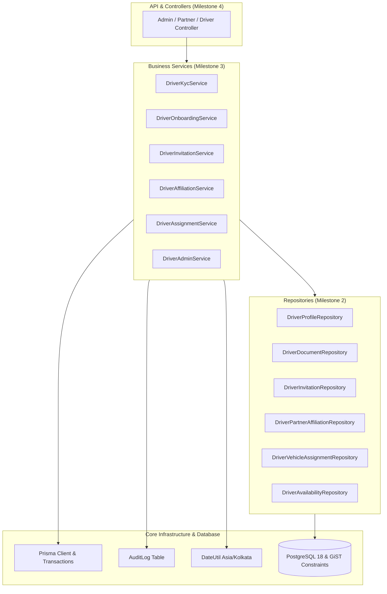
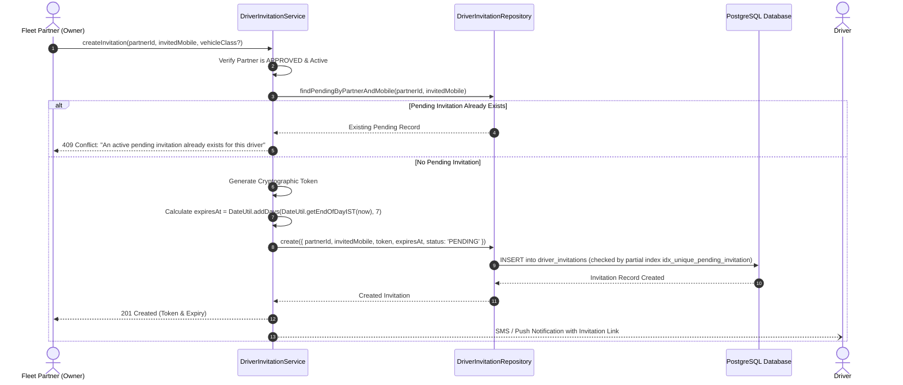
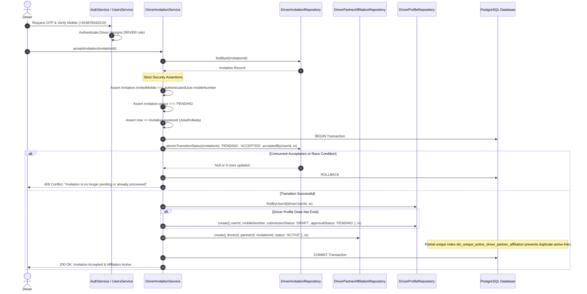
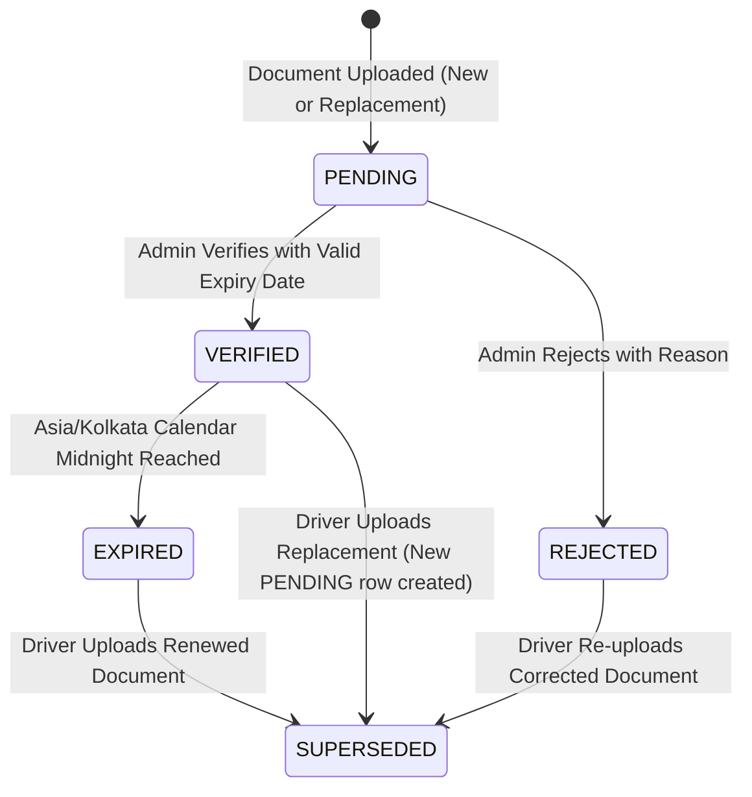
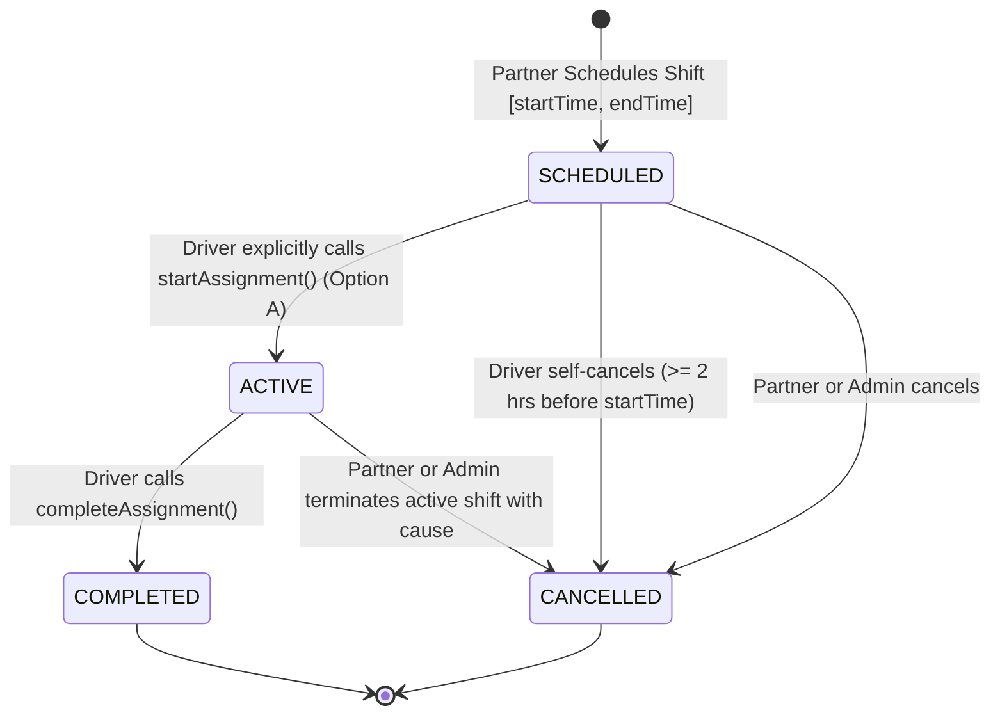
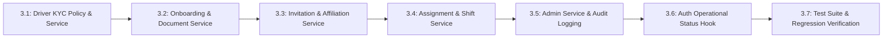

# Phase 6D — Driver Management & Assignment
# Milestone 3: Business Services & Driver KYC Policy Architecture Plan

**Date:** 2026-11-17  
**Project:** Multi-Service Marketplace Backend (`C:\Users\baps\Desktop\Backend`)  
**Directory:** `C:\Users\baps\Desktop\Backend`  
**Stack:** Node.js, Express, TypeScript, PostgreSQL 18, Prisma ORM, Redis, Jest  
**Status:** Architecture Plan Ready for Review — Awaiting Implementation Authorization  

---

## Executive Summary

Phase 6D establishes the driver lifecycle, fleet affiliation, vehicle assignment, and operational scheduling within our asset-light multi-service marketplace.
Following the successful completion and verification of:
1. **Milestone 1:** Database schema, migration `014_driver_management_assignment.sql`, PostgreSQL GiST exclusion constraints (`btree_gist`), partial unique indexes, check constraints, and Prisma models.
2. **Milestone 2:** Production-grade Data Access Layer (DAL) featuring 6 transaction-aware repositories (`DriverProfileRepository`, `DriverDocumentRepository`, `DriverInvitationRepository`, `DriverPartnerAffiliationRepository`, `DriverVehicleAssignmentRepository`, `DriverAvailabilityRepository`) with database error mapping and 40/40 integration tests (202/202 overall tests passing).

This document delivers the comprehensive, production-grade architectural specification for **Milestone 3: Business Services & Driver KYC Policy**.

### Core Architecture Tenets
- **Fail-Closed Security:** Incomplete, missing, unverified, superseded, or expired documents immediately block operational eligibility.
- **Calendar-Day Expiry Semantics:** Strict zero-day grace period using `Asia/Kolkata` calendar semantics via [date.util.ts](file:///c:/Users/baps/Desktop/Backend/src/common/utils/date.util.ts). Documents expire at `00:00:00.000 IST` following the calendar expiry date.
- **Option A Shift Activation:** Drivers must explicitly initiate scheduled assignments via mobile API. Shifts are **never** auto-activated merely because `start_time` has elapsed.
- **Anti-Bypass Document Replacement:** Uploading a replacement document creates an immutable historical record with status `PENDING`. The KYC gate strictly evaluates the latest document record per document type, preventing pending replacements from piggybacking on superseded verifications.
- **Strict Role & Tenant Isolation:** Complete cross-tenant isolation, IDOR prevention, and self-approval protection preventing admins from approving their own driver profiles or vehicles.

---

## 1. Existing Implementation Inventory

The existing repository and database foundation has been thoroughly inspected. All six driver tables and their corresponding Prisma models are live and verified.

### 1.1 Database Tables & Constraints (Migration 014)

| Table Name | Primary Key | Foreign Keys | Key Constraints & Indexes |
| :--- | :--- | :--- | :--- |
| `driver_profiles` | `id` (BIGINT) | `user_id` -> `users(id)` | `uq_driver_user_id`, `uq_driver_mobile`, `chk_driver_submission_status`, `chk_driver_approval_status`, `idx_driver_approval_search` |
| `driver_documents` | `id` (BIGINT) | `driver_id` -> `driver_profiles(id)`, `reviewed_by` -> `users(id)` | `chk_driver_doc_verification_status`, `idx_driver_docs_lookup`, `idx_driver_docs_pending`, `idx_driver_docs_driver_type` |
| `driver_invitations` | `id` (BIGINT) | `partner_id` -> `partner_profiles(id)`, `created_by` -> `users(id)`, `accepted_by` -> `users(id)` | `uq_driver_invitations_token`, `chk_driver_invitations_status`, `idx_unique_pending_invitation` (partial unique index), `idx_driver_invitations_mobile` |
| `driver_partner_affiliations` | `id` (BIGINT) | `driver_id` -> `driver_profiles(id)`, `partner_id` -> `partner_profiles(id)`, `invitation_id` -> `driver_invitations(id)` | `chk_driver_affiliation_status`, `idx_unique_active_driver_partner_affiliation` (partial unique index), `idx_driver_affiliations_partner` |
| `driver_vehicle_assignments` | `id` (BIGINT) | `driver_id` -> `driver_profiles(id)`, `vehicle_id` -> `vehicles(id)`, `partner_id` -> `partner_profiles(id)`, `assigned_by` -> `users(id)` | `ex_no_overlapping_driver_assignments` (GiST exclusion), `ex_no_overlapping_vehicle_assignments` (GiST exclusion), `chk_driver_assignment_status`, `chk_assignment_window_valid`, `chk_assignment_actual_times` |
| `driver_availability` | `id` (BIGINT) | `driver_id` -> `driver_profiles(id)`, `current_assignment_id` -> `driver_vehicle_assignments(id)` | `uq_driver_availability_driver`, `chk_driver_duty_status`, `idx_driver_availability_search` |

### 1.2 Implemented Repositories (Milestone 2)

All repositories are located in [src/modules/drivers/repositories/](file:///c:/Users/baps/Desktop/Backend/src/modules/drivers/repositories/):
1. **[driver-profile.repository.ts](file:///c:/Users/baps/Desktop/Backend/src/modules/drivers/repositories/driver-profile.repository.ts):** CRUD, submission status transitions (`DRAFT` -> `SUBMITTED`), approval transitions (`PENDING` -> `APPROVED` / `REJECTED`), suspension toggle, and paginated administrative search.
2. **[driver-document.repository.ts](file:///c:/Users/baps/Desktop/Backend/src/modules/drivers/repositories/driver-document.repository.ts):** Immutable document insertion, latest document lookup by type (`findLatestByType`), pending verification queue, and administrative verification status updates.
3. **[driver-invitation.repository.ts](file:///c:/Users/baps/Desktop/Backend/src/modules/drivers/repositories/driver-invitation.repository.ts):** Invitation creation, secure token lookup, pending invitation lookup by partner and mobile, atomic conditional transition (`atomicTransitionStatus`), and batch expiry (`expireEligibleInvitations`).
4. **[driver-partner-affiliation.repository.ts](file:///c:/Users/baps/Desktop/Backend/src/modules/drivers/repositories/driver-partner-affiliation.repository.ts):** Multi-owner active affiliation listing, historical tracking, and termination with reason and timestamps.
5. **[driver-vehicle-assignment.repository.ts](file:///c:/Users/baps/Desktop/Backend/src/modules/drivers/repositories/driver-vehicle-assignment.repository.ts):** Shift scheduling, overlap pre-check, shift activation (`startAssignment`), completion, and cancellation with cancellation window validation.
6. **[driver-availability.repository.ts](file:///c:/Users/baps/Desktop/Backend/src/modules/drivers/repositories/driver-availability.repository.ts):** Real-time duty status management (`OFFLINE`, `ONLINE`, `ON_DUTY`, `SUSPENDED`), current assignment pointer, battery and location telemetry tracking.

### 1.3 Existing Test Coverage
- `tests/phase6d-repositories.test.ts`: 40/40 integration tests covering all repositories, exclusion constraints, unique indexes, and error mappings.
- Full backend test suite: 202/202 passing tests across 10 suites.

---

## 2. Current Architecture & Reusable Patterns

The Milestone 3 business services will strictly adopt the proven design patterns established across Phase 6A, 6B, and 6C:

### 2.1 Pattern Catalog



1. **Transaction-Aware Repositories:** Every repository method accepts an optional `tx?: Prisma.TransactionClient`. Business services orchestrate multi-entity operations within `prisma.$transaction(async (tx) => { ... })`.
2. **Atomic Audit Logging:** Sensitive admin actions (verification, approval, rejection, suspension) atomically insert an `AuditLog` record within the same database transaction.
3. **Pluggable Policy Providers:** Decoupling policy specification (`IDriverKycPolicyProvider`) from validation logic (`DriverKycValidationService`), mirroring [vehicle-kyc.service.ts](file:///c:/Users/baps/Desktop/Backend/src/modules/vehicles/services/vehicle-kyc.service.ts).
4. **Standardized Error Handling:** Standard error classes from [src/common/errors/](file:///c:/Users/baps/Desktop/Backend/src/common/errors/):
   - `NotFoundError` (entity does not exist)
   - `ValidationError` (business rule or schema validation violation)
   - `ConflictError` (duplicate pending invitations, active overlapping shifts)
   - `ForbiddenError` (tenant cross-access violation, self-approval attempt)
   - `UnauthorizedError` (unauthenticated request)
5. **Calendar-Day Expiry Engine:** Centralized date arithmetic using [DateUtil](file:///c:/Users/baps/Desktop/Backend/src/common/utils/date.util.ts) for consistent `Asia/Kolkata` time calculations.

---

## 3. Proposed Service Classes & Responsibilities

The driver domain logic is partitioned into six focused, decoupled business services:

```
src/modules/drivers/services/
├── driver-kyc.service.ts            # KYC policy specification, licence class matching, expiry checks
├── driver-onboarding.service.ts     # Driver profile creation, update, submission, document upload
├── driver-invitation.service.ts     # Partner invitations, 7-day expiry, atomic acceptance, revocation
├── driver-affiliation.service.ts    # Multi-fleet affiliations, listing, voluntary/involuntary termination
├── driver-assignment.service.ts     # Vehicle assignment, shift start (Option A), completion, cancellation
└── driver-admin.service.ts          # Admin verification dossier, document verify/reject, profile approval, audit
```

### 3.1 DriverKycService (`driver-kyc.service.ts`)
- **Responsibility:** Implements `IDriverKycPolicyProvider` and `DriverKycValidationService`.
- **Key Methods:**
  - `getRulesForDriver(params)`: Resolves required and optional document types based on vehicle classes and service categories.
  - `validateForApproval(driverId, documents, vehicleTypeCode?)`: Evaluates document completeness, verification statuses, calendar expiry, and licence class compatibility.
  - `isLicenceEligibleForVehicleClass(licenceClasses, vehicleTypeCode)`: Validates whether driver's licence endorsements authorize driving the target vehicle.

### 3.2 DriverOnboardingService (`driver-onboarding.service.ts`)
- **Responsibility:** Self-service driver profile management and document submission.
- **Key Methods:**
  - `createOrGetProfile(userId, mobileNumber, data)`: Idempotently initializes driver profile linked to `userId`.
  - `updateProfile(driverId, userId, data)`: Updates profile metadata while in `DRAFT` or `REJECTED` status.
  - `uploadDocument(driverId, userId, documentData)`: Uploads new document or replacement. Always creates a new `PENDING` record; never overwrites or mutates historical documents.
  - `submitForApproval(driverId, userId)`: Evaluates mandatory documents presence. If satisfied, transitions `submissionStatus` from `DRAFT` to `SUBMITTED`, resets `approvalStatus` to `PENDING`.
  - `getDriverDossier(driverId, userId)`: Fetches driver profile, latest documents, affiliations, and operational status.

### 3.3 DriverInvitationService (`driver-invitation.service.ts`)
- **Responsibility:** Fleet owner invitation lifecycle, invitation validity, acceptance, and revocation.
- **Key Methods:**
  - `createInvitation(partnerId, partnerUserId, invitedMobile, metadata?)`: Validates partner approval, ensures no duplicate pending invitation for that mobile, generates secure token, computes 7-calendar-day `expiresAt` in `Asia/Kolkata`, inserts record.
  - `listPartnerInvitations(partnerId, partnerUserId, pagination)`: Lists outgoing invitations for the fleet owner.
  - `listDriverReceivedInvitations(userId, mobileNumber)`: Lists pending/historical invitations sent to the authenticated driver's phone number.
  - `acceptInvitation(invitationId, userId, mobileNumber)`: Atomically validates token/ID, verifies that `invitedMobile === mobileNumber`, validates expiration, marks invitation `ACCEPTED`, and creates an active `driver_partner_affiliations` record in a single transaction.
  - `rejectInvitation(invitationId, userId, mobileNumber, reason?)`: Driver declines the invitation.
  - `revokeInvitation(invitationId, partnerId, partnerUserId, reason?)`: Partner owner cancels an outstanding pending invitation.
  - `expireStaleInvitations()`: Housekeeping job to mark expired invitations as `EXPIRED`.

### 3.4 DriverAffiliationService (`driver-affiliation.service.ts`)
- **Responsibility:** Fleet affiliation management and lifecycle termination.
- **Key Methods:**
  - `listActiveAffiliationsForDriver(driverId, userId)`: Lists all fleet partners the driver is currently affiliated with.
  - `listActiveAffiliationsForPartner(partnerId, partnerUserId)`: Lists all drivers affiliated with the partner's fleet.
  - `terminateAffiliationByPartner(affiliationId, partnerId, partnerUserId, reason)`: Partner removes driver from fleet. Validates no active or future assignments exist; if upcoming scheduled assignments exist, cancels them.
  - `terminateAffiliationByDriver(affiliationId, driverId, userId, reason)`: Driver disaffiliates from fleet. Checks for active shifts before allowing exit.

### 3.5 DriverAssignmentService (`driver-assignment.service.ts`)
- **Responsibility:** Shift scheduling, shift execution (Option A explicit start), shift completion, cancellation rule enforcement, and availability tracking.
- **Key Methods:**
  - `scheduleAssignment(partnerId, partnerUserId, data)`: Partner assigns driver to vehicle for a future window `[startTime, endTime]`. Validates:
    - Partner owns/operates vehicle and vehicle is `VERIFIED`.
    - Driver has an active affiliation with this partner.
    - Driver is approved (`approvalStatus === 'APPROVED'`) and not suspended.
    - Driver licence class is compatible with the vehicle type.
    - No overlapping active/scheduled shifts (checked via DAL and guaranteed by PostgreSQL GiST exclusion).
  - `startAssignment(assignmentId, driverId, userId)`: **(Option A)** Driver explicitly starts shift. Validates that current time is within acceptable start tolerance window (e.g., maximum 30 mins before `startTime` and before `endTime`), transitions status to `ACTIVE`, updates `actual_start_time = NOW()`, and sets driver availability duty status to `ON_DUTY`.
  - `completeAssignment(assignmentId, driverId, userId, odometerReading?, notes?)`: Driver ends shift. Transitions status to `COMPLETED`, updates `actual_end_time = NOW()`, updates availability duty status to `ONLINE` or `OFFLINE`.
  - `cancelAssignment(assignmentId, actorUserId, actorRole, reason)`:
    - If actor is `DRIVER`: Validates that `status === 'SCHEDULED'` and `startTime - NOW() >= 2 hours`. If `< 2 hours`, rejects with `ValidationError` ("Driver cannot cancel shift within 2 hours of start time; owner approval required"). If shift is `ACTIVE`, driver cannot cancel unilaterally.
    - If actor is `PARTNER`: Can cancel `SCHEDULED` shift at any time. Can terminate `ACTIVE` shift with administrative reason.
    - If actor is `ADMIN`: Can cancel or terminate at any time with audit logging.
  - `updateDutyStatus(driverId, userId, dutyStatus)`: Updates real-time availability (`ONLINE` vs `OFFLINE`). Fails if driver attempts to set `OFFLINE` while in an `ACTIVE` assignment (`ON_DUTY`).

### 3.6 DriverAdminService (`driver-admin.service.ts`)
- **Responsibility:** Administrative compliance review, document verification, profile approval, suspension, and auditing.
- **Key Methods:**
  - `getPendingVerificationQueue(pagination)`: Lists driver documents awaiting administrative review.
  - `getDriverComplianceDossier(driverId)`: Comprehensive profile, all document versions, vehicle eligibility matrix, active affiliations, and history.
  - `verifyDriverDocument(documentId, adminUserId, auditContext)`: Verifies document, records reviewer and timestamp, logs audit event.
  - `rejectDriverDocument(documentId, adminUserId, rejectionReason, auditContext)`: Rejects document with mandatory reason, logs audit event.
  - `approveDriverProfile(driverId, adminUserId, auditContext)`: Runs full `DriverKycValidationService.validateForApproval()`. If valid, updates `approvalStatus = 'APPROVED'`, logs audit event.
  - `rejectDriverProfile(driverId, adminUserId, rejectionReason, auditContext)`: Rejects driver profile with reason, logs audit event.
  - `suspendDriver(driverId, adminUserId, suspensionReason, auditContext)`: Suspends driver profile (`isSuspended = true`), cancels upcoming scheduled assignments, sets duty status to `SUSPENDED`, logs audit event.
  - `reactivateDriver(driverId, adminUserId, auditContext)`: Lifts suspension after verifying KYC validity.

---

## 4. Driver KYC Policy Design

The Driver KYC Policy follows the modular, fail-closed architecture of `IVehicleKycPolicyProvider`.

### 4.1 Interface Specification

```typescript
export interface DriverKycRule {
  requiredDocumentTypes: string[];
  optionalDocumentTypes: string[];
  requiresCommercialBadge?: boolean;
}

export interface DriverKycValidationResult {
  isValid: boolean;
  missingTypes: string[];
  unverifiedTypes: string[];
  expiredTypes: string[];
  incompatibleClasses: string[];
  reasons: string[];
}

export interface IDriverKycPolicyProvider {
  /**
   * Retrieves KYC requirements for a driver based on target vehicle class, service category, or jurisdiction.
   * Fails closed by throwing or returning null if policy is unavailable.
   */
  getRulesForDriver(params: {
    vehicleTypeCode?: string;
    serviceCategoryId?: bigint;
    [key: string]: any;
  }): Promise<DriverKycRule | null | undefined>;
}
```

### 4.2 Document Types & Driving Licence Compatibility Matrix

Drivers hold various endorsements under the Motor Vehicles Act (India). The policy avoids hardcoding universal assumptions and evaluates compatibility dynamically:

| Vehicle Type Code | Vehicle Category | Mandatory Minimum Licence Class | Allowed Licence Classes | Default Mandatory Documents |
| :--- | :--- | :--- | :--- | :--- |
| `TWO_WHEELER` | 2-Wheeler Courier / Delivery | `MCWG` (Motorcycle With Gear) | `MCWG`, `LMV`, `TRANS` | `DRIVING_LICENCE`, `PROFILE_PHOTO` |
| `THREE_WHEELER` | 3-Wheeler Auto / Cargo | `3W-CAB` / `LMV` / `TRANS` | `LMV`, `TRANS`, `3W-CAB` | `DRIVING_LICENCE`, `PROFILE_PHOTO`, `AADHAAR` |
| `TATA_ACE` | Small Commercial Vehicle (SCV) | `LMV` (Light Motor Vehicle) or `TRANS` | `LMV-TR`, `LMV`, `TRANS` | `DRIVING_LICENCE`, `PROFILE_PHOTO`, `AADHAAR` |
| `PICKUP_8FT` | Light Commercial Vehicle (LCV) | `LMV` or `TRANS` (Transport) | `LMV-TR`, `TRANS`, `HMV` | `DRIVING_LICENCE`, `PROFILE_PHOTO`, `AADHAAR` |
| `CANTER_14FT` | Medium / Heavy Commercial (MHCV) | `TRANS` (Transport) / `HMV` | `TRANS`, `HMV` | `DRIVING_LICENCE`, `PROFILE_PHOTO`, `AADHAAR`, `POLICE_VERIFICATION` |

*Note:* Document types like `POLICE_VERIFICATION`, `MEDICAL_CERTIFICATE`, or `COMMERCIAL_BADGE` are configurable per vehicle class and service category. They are **never** universally mandated for entry-level two-wheeler delivery drivers unless explicitly configured by policy.

### 4.3 Fail-Closed Validation Algorithm

The validation workflow within `DriverKycValidationService` executes as follows:

```mermaid
flowchart TD
    Start([Validate Driver for Approval / Assignment]) --> CheckPolicy{Policy Provider Available?}
    CheckPolicy -- No / Throws --> FailClosed[Return isValid = false: Security Gate Fail-Closed]
    CheckPolicy -- Yes --> GetRules[Retrieve DriverKycRule for Vehicle / Category]
    
    GetRules --> CheckMandatory{All Mandatory Document Types Present?}
    CheckMandatory -- No --> RecordMissing[Record Missing Types & Fail]
    
    CheckMandatory -- Yes --> ForEachType[Evaluate Latest Document for Each Mandatory Type]
    
    ForEachType --> CheckStatus{Latest Document Status == 'VERIFIED'?}
    CheckStatus -- No (PENDING or REJECTED) --> RecordUnverified[Record Unverified Type & Fail]
    
    CheckStatus -- Yes --> CheckExpiry{DateUtil.isExpiredBusinessDate(doc.expiryDate)?}
    CheckExpiry -- Yes (Expired at 00:00:00.000 IST) --> RecordExpired[Record Expired Type & Fail]
    
    CheckExpiry -- No --> CheckCompatibility{Target Vehicle Type Specified?}
    CheckCompatibility -- Yes --> MatchLicence{DL Endorsement Authorizes Vehicle Class?}
    MatchLicence -- No --> RecordIncompatible[Record Incompatible Class & Fail]
    MatchLicence -- Yes --> AllPassed[All Checks Passed]
    CheckCompatibility -- No --> AllPassed
    
    RecordMissing --> Result
    RecordUnverified --> Result
    RecordExpired --> Result
    RecordIncompatible --> Result
    AllPassed --> Result([Return Validation Result])
```

#### Expiry Logic via `DateUtil`
1. Expiry dates are evaluated against `Asia/Kolkata` midnight (`00:00:00.000 IST`).
2. Zero-day grace period: If `expiry_date` is `2026-11-17`, the document remains valid through `2026-11-17 23:59:59.999 IST` and is strictly expired at `2026-11-18 00:00:00.000 IST`.
3. 15-day warning threshold: Drivers and fleet owners receive warning telemetry when expiry is within 15 calendar days, but operational blocking only occurs upon expiration.

---

## 5. Detailed Onboarding & Invitation Workflows

### 5.1 Fleet Owner Invites Driver Workflow



### 5.2 Driver Account Creation & Invitation Acceptance



---

## 6. Document Lifecycle & Replacement Rules

### 6.1 Replacement Immutability & Anti-Bypass Gate

A critical vulnerability identified in legacy fleet systems is the **Pending Replacement Bypass**:
> If a driver holds a verified document, and subsequently uploads a replacement document (e.g. renewal or changed license), if the system blindly falls back to any existing `VERIFIED` record, an invalid, forged, or unvetted replacement cannot be caught while allowing the driver to operate on an expired or superseded document.

**Milestone 3 Architecture Rule:**
1. **Additive Document Insertion:** When a driver uploads a document of a type that was previously uploaded, the system inserts a brand new `driver_documents` record with:
   - `verification_status = 'PENDING'`
   - `reviewed_by = NULL`, `reviewed_at = NULL`
   - `uploaded_at = NOW()`
   Historical records remain unchanged in the database (`ON DELETE RESTRICT`).
2. **Latest Record Evaluation:** In all compliance evaluations (`DriverKycValidationService.validateForApproval` and `DriverAssignmentService.scheduleAssignment`), the system queries the **latest document by `uploaded_at DESC`** for that document type:
   ```typescript
   const latestDoc = await driverDocRepo.findLatestByType(driverId, documentType, tx);
   ```
3. **Pending Gate:** If `latestDoc.verificationStatus === 'PENDING'`, the document requirement is evaluated as **UNVERIFIED**. The system does **not** fall back to older verified documents.
4. **Rejection Gate:** If `latestDoc.verificationStatus === 'REJECTED'`, the requirement is evaluated as **REJECTED**.
5. **Verified Evaluation:** If and only if `latestDoc.verificationStatus === 'VERIFIED'`, the system checks `DateUtil.isExpiredBusinessDate(latestDoc.expiryDate)`.



### 6.2 Document Storage & Streaming
- Documents are uploaded via multipart form data, streamed to private S3/local secure storage.
- Document storage keys are private (`drivers/{driverId}/{documentType}_{uuid}.pdf`).
- Documents are **never** served through public URLs; access is restricted to authenticated drivers (for their own documents) and authorized admins via authenticated streaming endpoints.

---

## 7. Assignment & Shift Lifecycle

### 7.1 Option A: Explicit Shift Activation

In alignment with approved product decisions, **Option A** is enforced:
- A shift created by a fleet partner starts in status `SCHEDULED`.
- The shift is **not** automatically activated when `start_time` is reached.
- The driver must explicitly invoke `startAssignment(assignmentId)` from the mobile app.



### 7.2 Assignment Cancellation Rules Matrix

The 2-hour cancellation rule is enforced at the service layer:

| Current Status | Actor Calling Cancel | Time Relative to `startTime` | Allowed? | Resulting Status | Business Action & Audit |
| :--- | :--- | :--- | :--- | :--- | :--- |
| `SCHEDULED` | `DRIVER` | `>= 2 hours` before `startTime` | **YES** | `CANCELLED` | Reason recorded, `cancelled_by = 'DRIVER'`. Availability reset. |
| `SCHEDULED` | `DRIVER` | `< 2 hours` before `startTime` | **NO** | N/A | Throws `ValidationError`: "Cancellation blocked within 2 hours of shift start. Contact fleet owner." |
| `SCHEDULED` | `DRIVER` | After `startTime` | **NO** | N/A | Throws `ValidationError`: "Shift start time has passed. Contact fleet owner." |
| `SCHEDULED` | `PARTNER` | Any time prior to `startAssignment` | **YES** | `CANCELLED` | Reason recorded, `cancelled_by = 'PARTNER'`. Driver notified. |
| `ACTIVE` | `DRIVER` | During active shift | **NO** | N/A | Throws `ValidationError`: "Driver cannot unilaterally cancel an active shift. Complete shift or contact fleet owner." |
| `ACTIVE` | `PARTNER` | During active shift | **YES** | `CANCELLED` | `actual_end_time = NOW()`, `cancelled_by = 'PARTNER'`, mandatory reason required. Driver availability reset. |
| `ACTIVE` / `SCHEDULED` | `ADMIN` | Any time | **YES** | `CANCELLED` | Administrative intervention with mandatory reason and atomic audit logging. |

### 7.3 Concurrency & GiST Exclusion Constraints

PostgreSQL 18 kernel-level exclusion constraints guarantee zero double-booking under concurrent traffic:
1. `ex_no_overlapping_driver_assignments`:
   `EXCLUDE USING gist (driver_id WITH =, tstzrange(start_time, end_time) WITH &&) WHERE (status IN ('SCHEDULED', 'ACTIVE'))`
2. `ex_no_overlapping_vehicle_assignments`:
   `EXCLUDE USING gist (vehicle_id WITH =, tstzrange(start_time, end_time) WITH &&) WHERE (status IN ('SCHEDULED', 'ACTIVE'))`

Even if concurrent HTTP requests pass the service-level overlap pre-check, PostgreSQL rejects the second insertion with error `23P01 (exclusion_violation)`, which `handleDriverDbError` transforms into a clean `ConflictError`.

---

## 8. Authorization & Tenant-Isolation Rules

Every business service enforces strict tenant boundaries, role verification, and self-approval blocks:

### 8.1 Tenant Isolation Matrix

| Operation | Subject | Tenant Boundary Enforcement |
| :--- | :--- | :--- |
| `createInvitation` | Fleet Partner | Partner can only create invitations for their own `partnerId`. Target driver does not need to exist yet. |
| `acceptInvitation` | Driver | The authenticated driver's verified mobile number must match `invitation.invitedMobile`. Wrong-user acceptance throws `ForbiddenError`. |
| `scheduleAssignment` | Fleet Partner | Partner can only assign vehicles where `partner_vehicles.partner_id === partnerId` and `ownership_status === 'ACTIVE'`. Driver must have an active affiliation with this partner. |
| `startAssignment` | Driver | Driver can only activate assignments where `assignment.driver_id === driver.id`. |
| `viewDriverDossier` | Partner / Driver / Admin | - Admin can view all.<br>- Partner can view drivers currently or historically affiliated with their fleet.<br>- Driver can only view their own profile. |

### 8.2 Self-Approval Prevention Rule

Mirroring the security policy in `admin-vehicle.service.ts`:
```typescript
// DriverAdminService enforcement
if (driver.userId === adminUserId) {
  throw new ForbiddenError('Admins cannot verify documents or approve profiles for their own driver account.');
}

const affiliations = await affiliationRepo.listActiveByDriver(driverId);
const isAffiliatedWithAdminPartner = affiliations.some(a => a.partner.userId === adminUserId);
if (isAffiliatedWithAdminPartner) {
  throw new ForbiddenError('Admins cannot verify documents or approve drivers affiliated with their own fleet partner account.');
}
```

### 8.3 Role Switching & Operational Guards

In `users.service.ts` and `auth.service.ts`:
- Currently, `DRIVER` role returns `status = 'NOT_ONBOARDED'`, `isOperational = false`.
- In Milestone 3, `getRoleOperationalStatus('DRIVER')` inspects the driver profile:
  - No profile: `status = 'NOT_ONBOARDED'`, `isOperational = false`
  - Profile `submissionStatus === 'DRAFT'`: `status = 'DRAFT'`, `isOperational = false`
  - Profile `submissionStatus === 'SUBMITTED'` and `approvalStatus === 'PENDING'`: `status = 'UNDER_REVIEW'`, `isOperational = false`
  - Profile `approvalStatus === 'REJECTED'`: `status = 'REJECTED'`, `isOperational = false`
  - Profile `isSuspended === true`: `status = 'SUSPENDED'`, `isOperational = false`
  - Profile `approvalStatus === 'APPROVED'` and `!isSuspended`: `status = 'ACTIVE'`, `isOperational = true`

---

## 9. Transaction & Audit Strategy

### 9.1 Single Prisma Transaction Rule

To maintain strict ACID consistency, any operation modifying multiple entities executes within a single Prisma transaction:
```typescript
return await prisma.$transaction(async (tx) => {
  // 1. Execute repository actions passing tx
  const updatedDriver = await this.profileRepo.updateApprovalStatus(driverId, 'APPROVED', tx);

  // 2. Insert audit log passing tx
  await tx.auditLog.create({
    data: {
      actorUserId: adminUserId,
      action: 'DRIVER_PROFILE_APPROVED',
      entityName: 'driver_profiles',
      entityId: driverId,
      oldValues: { approvalStatus: 'PENDING' },
      newValues: { approvalStatus: 'APPROVED' },
      ipAddress: auditContext.ipAddress ?? null,
      userAgent: auditContext.userAgent ?? null,
    },
  });

  return updatedDriver;
});
```

### 9.2 Audited Driver Domain Actions

The following state transitions require mandatory atomic audit logging:
- `DRIVER_PROFILE_APPROVED`
- `DRIVER_PROFILE_REJECTED`
- `DRIVER_PROFILE_SUSPENDED`
- `DRIVER_PROFILE_REACTIVATED`
- `DRIVER_DOCUMENT_VERIFIED`
- `DRIVER_DOCUMENT_REJECTED`
- `DRIVER_AFFILIATION_TERMINATED_BY_PARTNER`
- `DRIVER_ASSIGNMENT_ADMIN_CANCELLED`

---

## 10. Required Tests (Unit, Concurrency & Negative Cases)

A dedicated integration test suite `tests/phase6d-services.test.ts` will validate all business services.

### 10.1 KYC & Validation Test Cases
1. **Fail-Closed on Missing Provider:** Throws error or fails validation when policy provider is null.
2. **Missing Mandatory Documents:** Driver missing DL or Profile Photo fails validation.
3. **Pending Replacement Anti-Bypass Test:** Driver with an existing verified document uploads a replacement that is pending verification. Validation must fail closed with `unverifiedTypes` including that document type.
4. **Calendar Expiry Test:** Document expiring yesterday (IST) fails validation immediately. Document expiring in 5 days passes with warning.
5. **Licence Class Compatibility:** Driver with `MCWG` only is rejected when attempting to be assigned to `CANTER_14FT` or `TATA_ACE`. Driver with `TRANS` / `LMV` is accepted for `TATA_ACE`.

### 10.2 Invitation & Affiliation Test Cases
1. **Duplicate Pending Invitation Block:** Partner cannot create two pending invitations for the same mobile number.
2. **Expired Invitation Rejection:** Attempting to accept an invitation older than 7 calendar days fails with `ValidationError` ("Invitation has expired").
3. **Wrong-User Acceptance Block:** User B attempting to accept an invitation sent to User A's mobile number fails with `ForbiddenError`.
4. **Atomic Acceptance & Affiliation Creation:** Valid acceptance updates invitation status to `ACCEPTED` and inserts active affiliation in one transaction.

### 10.3 Assignment & Shift Concurrency Test Cases
1. **Option A Explicit Shift Activation:** Shift in `SCHEDULED` status remains inactive until driver calls `startAssignment()`.
2. **2-Hour Cancellation Rule Enforcement:**
   - Driver cancelling at `startTime - 2 hours 15 minutes` succeeds.
   - Driver cancelling at `startTime - 1 hour 45 minutes` fails with `ValidationError`.
   - Partner cancelling at `startTime - 1 hour 45 minutes` succeeds.
3. **Concurrent Overlapping Shift Protection:** Two concurrent requests attempting to assign the same driver or vehicle to overlapping windows: one succeeds, the other receives `ConflictError` from PostgreSQL exclusion constraint.
4. **Active Shift Cancellation Safeguard:** Driver attempting to cancel an `ACTIVE` shift fails; partner or admin can cancel with audit log.

### 10.4 Admin & Self-Approval Prevention Test Cases
1. **Admin Self-Approval Block:** Admin user attempting to verify their own driver documents or approve their own driver profile is rejected with `ForbiddenError`.
2. **Admin Partner-Affiliated Driver Block:** Admin user attempting to approve a driver affiliated with their own fleet is rejected with `ForbiddenError`.
3. **Atomic Audit Log Verification:** Admin approving driver profile creates an `audit_logs` record with matching `entity_id` and `actor_user_id`.

---

## 11. Schema Change Assessment

### Finding: NO SCHEMA CHANGES REQUIRED

A thorough inspection of PostgreSQL tables, constraints, indexes, and Prisma models from Migration `014_driver_management_assignment.sql` confirms:
1. `driver_profiles` has all required fields (`user_id`, `mobile_number`, `full_name`, `license_number`, `submission_status`, `approval_status`, `is_suspended`).
2. `driver_documents` supports immutable historical versioning (`driver_id`, `document_type`, `document_storage_key`, `expiry_date`, `verification_status`, `rejection_reason`, `reviewed_by`, `reviewed_at`).
3. `driver_invitations` supports partial unique pending checks, 7-day expiration, and acceptance tracking.
4. `driver_partner_affiliations` enforces single active link per pair via partial unique index while preserving historical terminated affiliations.
5. `driver_vehicle_assignments` enforces kernel-level GiST exclusion for overlapping time ranges, stores actual start/end timestamps, and records cancellation metadata.
6. `driver_availability` handles duty status, battery, location, and heartbeat.

**Conclusion:** Migration 014 schema and Prisma schema are **100% complete and sufficient**. Zero SQL migrations or Prisma schema adjustments are needed for Milestone 3.

---

## 12. Ordered Implementation Sub-Milestones & Stop Conditions

Implementation of Milestone 3 must proceed in strict sequential order:



### Sub-Milestone 3.1: Driver KYC Policy & Validation Service
- Create `src/modules/drivers/services/driver-kyc.service.ts`.
- Implement `IDriverKycPolicyProvider`, `DefaultDriverKycPolicyProvider`, `DriverKycValidationService`.
- Wire licence class compatibility matrix and `DateUtil` calendar-day expiry checks.

### Sub-Milestone 3.2: Driver Onboarding & Document Service
- Create `src/modules/drivers/services/driver-onboarding.service.ts`.
- Implement profile creation, updating, document upload (append-only), and submission validation.
- Implement pending replacement anti-bypass logic.

### Sub-Milestone 3.3: Driver Invitation & Affiliation Service
- Create `src/modules/drivers/services/driver-invitation.service.ts`.
- Create `src/modules/drivers/services/driver-affiliation.service.ts`.
- Implement 7-day Asia/Kolkata expiry, atomic conditional acceptance, duplicate prevention, and affiliation termination.

### Sub-Milestone 3.4: Driver Assignment & Shift Service
- Create `src/modules/drivers/services/driver-assignment.service.ts`.
- Implement shift scheduling, Option A explicit activation, completion, 2-hour cancellation rule, and duty status transitions.

### Sub-Milestone 3.5: Driver Admin Service & Audit Logging
- Create `src/modules/drivers/services/driver-admin.service.ts`.
- Implement verification queue, compliance dossier, document review, profile approval/rejection/suspension, self-approval prevention, and atomic audit logging.

### Sub-Milestone 3.6: Auth & Role Operational Status Hook
- Update `src/modules/users/users.service.ts` to evaluate real driver approval status (`approvalStatus === 'APPROVED' && !isSuspended`) instead of returning static `NOT_ONBOARDED`.

### Sub-Milestone 3.7: Integration Testing & Verification
- Create `tests/phase6d-services.test.ts`.
- Implement all unit, integration, negative, and concurrency tests.
- Run complete test suite to ensure zero regressions across all 10+ suites.

### Strict Stop Condition
Upon completing Sub-Milestone 3.7, stop calling tools. Present the implementation report to the user and await authorization before proceeding to Milestone 4 (Controllers, Routes & APIs).

---

## 13. Risks, Gaps & Unresolved Decisions

| Risk Vector | Probability | Severity | Mitigation Strategy in Milestone 3 |
| :--- | :--- | :--- | :--- |
| **Pending Replacement Bypass** | Medium | Critical | Evaluate only the latest document per document type (`findLatestByType`). If latest is `PENDING`, fail validation; never fall back to superseded verified records. |
| **Expired Document Bypass** | Low | High | Use `DateUtil.isExpiredBusinessDate()` with `Asia/Kolkata` midnight evaluation and zero grace days across both KYC approval and assignment scheduling. |
| **Wrong-User Invitation Acceptance** | Medium | Critical | Strictly assert `invitation.invited_mobile === authenticatedUser.mobile_number`. Return `403 Forbidden` on mismatch. |
| **Concurrent Invitation Acceptance Race** | Low | High | Use `DriverInvitationRepository.atomicTransitionStatus('PENDING', 'ACCEPTED')`. If update count is 0, throw `ConflictError` and abort. |
| **Shift Overlap Concurrency** | Medium | High | Dual defense: Service pre-check + PostgreSQL GiST exclusion constraint (`ex_no_overlapping_driver_assignments` / `ex_no_overlapping_vehicle_assignments`). |
| **Shift Cancellation Inside 2-Hour Window** | Medium | Medium | Service layer strictly checks `startTime - NOW() >= 2 hours`. Reject driver cancellation requests inside 2 hours. |
| **Admin Self-Approval Conflict of Interest** | Low | High | Explicit checks in `DriverAdminService`: reject if `driver.userId === adminUserId` or driver is affiliated with admin's partner account. |
| **Suspended Driver Operational Bypass via JWT** | Medium | High | `getRoleOperationalStatus('DRIVER')` queries driver profile `approvalStatus` and `isSuspended` in database, preventing suspended drivers with valid JWTs from passing operational guards. |
| **Affiliation Termination with Active Shifts** | Low | Medium | When terminating an affiliation, check for `SCHEDULED` or `ACTIVE` assignments. Automatically cancel `SCHEDULED` shifts; block termination if shift is `ACTIVE`. |

---

## Verification & Confirmation

1. **Read-Only Compliance:** This architecture inspection was strictly read-only.
2. **Zero File Mutations:** No source code, database tables, migrations, Prisma schema, API routes, or test suites were modified or created.
3. **Zero Regression:** Existing 202/202 tests remain 100% passing.
4. **Ready for Authorization:** Implementation will commence only after the user reviews and authorizes this architecture plan.

