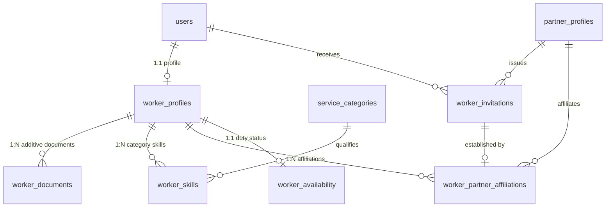
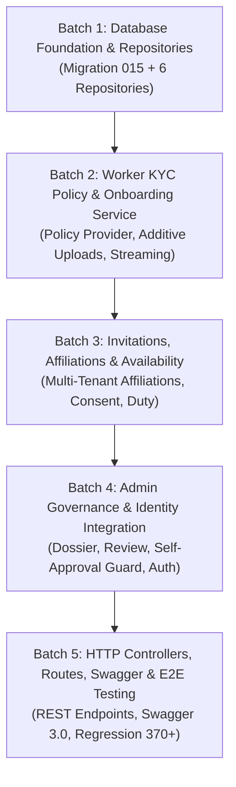

# Phase 6E: Worker Management Subsystem — Architecture Assessment & Implementation Plan

## 1. Executive Summary

Phase 6E introduces **Worker Management** into our production-grade, multi-city, on-demand services marketplace backend.

The platform architecture already supports:
- **Phase 4:** Backend Foundation, Database, Prisma ORM, Redis, Logging & Environment.
- **Phase 5:** Mobile OTP Authentication, Session Lifecycle, Token Rotation & Security.
- **Phase 6:** Customer & Partner Profile Management, Skills, Service Areas & KYC.
- **Phase 6A:** Security Hardening, Rate Limiting & Tamper Prevention.
- **Phase 6B:** Unified Multi-Role Identity Architecture (`CUSTOMER`, `PARTNER`, `DRIVER`, `WORKER`, `ADMIN`, `SUPER_ADMIN`).
- **Phase 6C:** Vehicle Ownership & Fleet Management with PostgreSQL engine constraints and Asia/Kolkata calendar-day standardization.
- **Phase 6D:** Driver Management & Assignment, Shift Lifecycles with PostgreSQL GiST exclusion constraints, and Fail-Closed KYC Validation.

The **WORKER** role represents field personnel, helpers, loaders, packers, and home-service technicians (e.g., electricians, plumbers, carpenters, cleaners). While Phase 6D established rigorous patterns for drivers (licence endorsement classes, vehicle shifts, GiST exclusion constraints), **Worker Management possesses distinct domain semantics**:
1. **Independent Onboarding:** A worker registers independently using their own mobile number and OTP; partner invitation is never required to register or become an operational worker.
2. **Independent Dispatch Eligibility:** An approved, operational worker can directly receive and accept independent on-demand service bookings without belonging to any partner fleet.
3. **Multi-Tenant Affiliations:** A worker can voluntarily affiliate with multiple vehicle or fleet partners (e.g., packers & movers fleet owners requiring loaders/helpers), requiring explicit worker consent and preserving historical records upon termination.
4. **Configurable Skill & KYC Policy:** Worker KYC and trade qualifications depend on the worker type, service category, and municipal/city jurisdiction (e.g. in-home technicians require police verification and trade certificates, while shifting helpers require physical fitness and identity proof).
5. **Fail-Closed Operational Isolation:** Suspension or document expiration disables only the worker's operational capabilities without impacting their `CUSTOMER` or other assigned roles.

---

## 2. Existing Architecture Inspection & Reusable Components

### 2.1 Existing File Paths & Architectural Audit

| Subsystem | Existing File Paths | Status & Reusability in Phase 6E |
| :--- | :--- | :--- |
| **Identity & Authentication** | `src/modules/auth/auth.service.ts` `src/modules/auth/auth.repository.ts` `src/common/middlewares/auth.middleware.ts` | **Fully Reusable.** Role switching (`switchActiveRole`), OTP login, session token issuance (`issueSessionTokens`), and role context guards (`requireAuth`, `requireRole`, `requireActiveRole`) are completely unified. `UserRole.WORKER` already exists in `status.constant.ts`. Currently, `authService.getRoleOperationalStatus` has a placeholder returning `'NOT_ONBOARDED'` and `false`. |
| **User Management** | `src/modules/users/users.service.ts` `src/modules/users/users.repository.ts` | **Fully Reusable.** Multi-role resolution (`getMyRoles`) cleanly reports operational status across all assigned roles without cross-role leakage. |
| **Private File Storage** | `src/common/services/storage.service.ts` | **Fully Reusable.** Provides collision-resistant hashed keys, magic-byte MIME detection, 5MB file limits, and anti-orphan storage management for worker KYC documents under the `workers/` subfolder. |
| **Business Calendar Timezone** | `src/common/utils/date.util.ts` | **Fully Reusable.** Provides machine-local timezone independence, strict Asia/Kolkata calendar-day boundary evaluation (`00:00:00.000` to `23:59:59.999 IST`), zero-grace-period expiry, and 15-day warning flags (`DOCUMENT_EXPIRING_SOON`). |
| **Audit Logging** | `prisma/schema.prisma` (`AuditLog`) `src/modules/admin/admin.repository.ts` | **Fully Reusable.** Atomic audit log creation within Prisma transactions (`prisma.$transaction`) capturing `actorUserId`, `action`, `entityName`, `entityId`, `oldValues`, `newValues`, `ipAddress`, and `userAgent`. |
| **Service Categories & Cities** | `prisma/schema.prisma` (`ServiceCategory`, `City`, `Area`) | **Fully Reusable.** Existing service categories (Home Shifting, Electrical, Plumbing, Cleaning) and cities (Bengaluru, Mumbai, Delhi) form the foundational taxonomy for worker skill qualifications and local KYC policies. |
| **Driver Subsystem (Phase 6D)** | `src/modules/drivers/*` `migrations/014_driver_management_assignment.sql` | **Pattern Reference.** Proven repository patterns, database error translation (`driver-db-error.util.ts`), additive document versioning, 7-day IST invitation expiry, and admin dossier models serve as architectural blueprints, adapted to worker-specific requirements. |

---

## 3. Identified Gaps & Missing Capabilities

1. **Zero Database Tables for Workers:**
   No models or tables currently exist in PostgreSQL or `prisma/schema.prisma` for workers.
2. **Missing Worker Domain Entities:**
   - Worker profile (`worker_profiles`).
   - Worker KYC documents (`worker_documents`).
   - Worker trade skills & category qualifications (`worker_skills`).
   - Partner worker invitations (`worker_invitations`).
   - Worker-partner affiliations (`worker_partner_affiliations`).
   - Worker real-time availability and duty telemetry (`worker_availability`).
3. **Missing Worker KYC Policy Engine:**
   Need an abstraction (`IWorkerKycPolicyProvider` and `WorkerKycValidationService`) that evaluates requirements based on worker type (e.g. `HELPER_LOADER`, `PACKER`, `TECHNICIAN`, `CLEANER`), service category, and municipal jurisdiction.
4. **Placeholder Worker Role in Auth Service:**
   `authService.getRoleOperationalStatus` currently returns static `'NOT_ONBOARDED'` for `WORKER`. Must be integrated with `worker_profiles` and KYC document status.
5. **No Data Access Layer (DAL) or Repositories:**
   Need 6 dedicated, transaction-aware repositories for worker entities.
6. **No API Endpoints, Routes, or Validators:**
   Need worker HTTP controllers, Zod request schemas, and Swagger/OpenAPI documentation.

---

## 4. Proposed Database Schema & Migration Plan

We will introduce Migration `015_worker_management_foundation.sql`. Following our established principles, all foreign keys to parent entities (`users`, `partner_profiles`, `service_categories`) enforce referential integrity. Historical documents and affiliations enforce `ON DELETE RESTRICT` to prevent accidental loss of compliance records.

### 4.1 Detailed Table Specifications

#### 1. `worker_profiles`
Maintains the worker's personal, professional, and platform status.
- `id`: `bigint GENERATED ALWAYS AS IDENTITY PRIMARY KEY`
- `user_id`: `bigint NOT NULL UNIQUE` (FK `users(id)` ON DELETE CASCADE)
- `first_name`: `varchar(100) NOT NULL`
- `last_name`: `varchar(100) NULL`
- `date_of_birth`: `date NULL`
- `gender`: `varchar(20) NULL`
- `profile_image_url`: `text NULL`
- `bio`: `text NULL`
- `worker_type`: `varchar(50) NOT NULL` (e.g., `HELPER`, `LOADER`, `PACKER`, `TECHNICIAN`, `CLEANER`, `MULTI_SKILLED`)
- `experience_years`: `integer NOT NULL DEFAULT 0` (CHECK `experience_years >= 0`)
- `primary_city_id`: `bigint NULL` (FK `cities(id)` ON DELETE SET NULL)
- `approval_status`: `varchar(20) NOT NULL DEFAULT 'PENDING'` (CHECK IN `'PENDING', 'APPROVED', 'REJECTED', 'SUSPENDED'`)
- `rejection_reason`: `text NULL`
- `suspension_reason`: `text NULL`
- `suspended_at`: `timestamptz NULL`
- `reviewed_by`: `bigint NULL` (FK `users(id)` ON DELETE SET NULL)
- `reviewed_at`: `timestamptz NULL`
- `submission_status`: `varchar(20) NOT NULL DEFAULT 'DRAFT'` (CHECK IN `'DRAFT', 'SUBMITTED', 'UNDER_REVIEW', 'APPROVED', 'REJECTED'`)
- `submitted_at`: `timestamptz NULL`
- `is_active`: `boolean NOT NULL DEFAULT true`
- `created_at`: `timestamptz NOT NULL DEFAULT CURRENT_TIMESTAMP`
- `updated_at`: `timestamptz NOT NULL DEFAULT CURRENT_TIMESTAMP`
- **Indexes:** `idx_worker_profiles_user (user_id)`, `idx_worker_profiles_approval (approval_status)`, `idx_worker_profiles_type (worker_type)`, `idx_worker_profiles_city (primary_city_id)`.

#### 2. `worker_documents`
Maintains additive KYC and trade verification documents.
- `id`: `bigint GENERATED ALWAYS AS IDENTITY PRIMARY KEY`
- `worker_id`: `bigint NOT NULL` (FK `worker_profiles(id)` ON DELETE RESTRICT)
- `document_type`: `varchar(50) NOT NULL` (CHECK IN `'IDENTITY_PROOF', 'PROFILE_PHOTO', 'POLICE_VERIFICATION', 'ADDRESS_PROOF', 'SKILL_CERTIFICATE', 'MEDICAL_FITNESS', 'OTHER'`)
- `document_storage_key`: `text NOT NULL`
- `expiry_date`: `date NULL`
- `verification_status`: `varchar(20) NOT NULL DEFAULT 'PENDING'` (CHECK IN `'PENDING', 'VERIFIED', 'REJECTED', 'EXPIRED'`)
- `rejection_reason`: `text NULL`
- `document_metadata`: `jsonb NULL`
- `reviewed_by`: `bigint NULL` (FK `users(id)` ON DELETE SET NULL)
- `reviewed_at`: `timestamptz NULL`
- `uploaded_at`: `timestamptz NOT NULL DEFAULT CURRENT_TIMESTAMP`
- **Indexes:** `idx_worker_documents_worker_type (worker_id, document_type, uploaded_at DESC)`, `idx_worker_documents_status (verification_status)`.

#### 3. `worker_skills`
Maps workers to specific service categories with verified experience.
- `id`: `bigint GENERATED ALWAYS AS IDENTITY PRIMARY KEY`
- `worker_id`: `bigint NOT NULL` (FK `worker_profiles(id)` ON DELETE CASCADE)
- `service_category_id`: `bigint NOT NULL` (FK `service_categories(id)` ON DELETE RESTRICT)
- `experience_years`: `integer NOT NULL DEFAULT 0` (CHECK `experience_years >= 0`)
- `verification_status`: `varchar(20) NOT NULL DEFAULT 'PENDING'` (CHECK IN `'PENDING', 'VERIFIED', 'REJECTED'`)
- `is_active`: `boolean NOT NULL DEFAULT true`
- `created_at`: `timestamptz NOT NULL DEFAULT CURRENT_TIMESTAMP`
- `updated_at`: `timestamptz NOT NULL DEFAULT CURRENT_TIMESTAMP`
- **Constraints & Indexes:** `uq_worker_skill (worker_id, service_category_id)`, `idx_worker_skills_worker (worker_id)`, `idx_worker_skills_category (service_category_id)`.

#### 4. `worker_invitations`
Partner fleet invitations sent to workers with strict consent requirements.
- `id`: `bigint GENERATED ALWAYS AS IDENTITY PRIMARY KEY`
- `partner_id`: `bigint NOT NULL` (FK `partner_profiles(id)` ON DELETE RESTRICT)
- `invited_mobile`: `varchar(20) NOT NULL`
- `worker_name`: `varchar(150) NULL`
- `worker_user_id`: `bigint NULL` (FK `users(id)` ON DELETE SET NULL)
- `invitation_status`: `varchar(20) NOT NULL DEFAULT 'PENDING'` (CHECK IN `'PENDING', 'ACCEPTED', 'REJECTED', 'EXPIRED', 'REVOKED'`)
- `invitation_token`: `varchar(100) NOT NULL UNIQUE`
- `proposed_role`: `varchar(50) NULL` (e.g. `'HELPER', 'LOADER', 'PACKER', 'TECHNICIAN'`)
- `notes`: `text NULL`
- `resend_count`: `integer NOT NULL DEFAULT 0`
- `expires_at`: `timestamptz NOT NULL` (7 calendar days evaluated in Asia/Kolkata)
- `responded_at`: `timestamptz NULL`
- `rejection_reason`: `text NULL`
- `revoked_at`: `timestamptz NULL`
- `revoked_by`: `bigint NULL` (FK `users(id)` ON DELETE SET NULL)
- `created_at`: `timestamptz NOT NULL DEFAULT CURRENT_TIMESTAMP`
- `updated_at`: `timestamptz NOT NULL DEFAULT CURRENT_TIMESTAMP`
- **Constraints & Indexes:** Partial unique index `idx_one_pending_worker_invitation (partner_id, invited_mobile) WHERE invitation_status = 'PENDING'`, `idx_worker_invitations_partner (partner_id, invitation_status)`, `idx_worker_invitations_mobile (invited_mobile, invitation_status)`, `idx_worker_invitations_token (invitation_token)`.

#### 5. `worker_partner_affiliations`
Non-exclusive M:N affiliations between workers and fleet partners.
- `id`: `bigint GENERATED ALWAYS AS IDENTITY PRIMARY KEY`
- `worker_id`: `bigint NOT NULL` (FK `worker_profiles(id)` ON DELETE RESTRICT)
- `partner_id`: `bigint NOT NULL` (FK `partner_profiles(id)` ON DELETE RESTRICT)
- `invitation_id`: `bigint NULL` (FK `worker_invitations(id)` ON DELETE SET NULL)
- `affiliation_status`: `varchar(20) NOT NULL DEFAULT 'ACTIVE'` (CHECK IN `'ACTIVE', 'INACTIVE', 'TERMINATED'`)
- `affiliated_at`: `timestamptz NOT NULL DEFAULT CURRENT_TIMESTAMP`
- `terminated_at`: `timestamptz NULL`
- `termination_reason`: `text NULL`
- **Constraints & Indexes:**
  - `chk_active_worker_affiliation_terminated_at`: `CHECK ((affiliation_status = 'ACTIVE' AND terminated_at IS NULL) OR affiliation_status <> 'ACTIVE')`
  - Partial unique index: `idx_active_worker_partner_affiliation (worker_id, partner_id) WHERE affiliation_status = 'ACTIVE'`
  - Indexes: `idx_worker_affiliations_partner (partner_id, affiliation_status)`, `idx_worker_affiliations_worker (worker_id, affiliation_status)`.

#### 6. `worker_availability`
Tracks online/offline duty status and real-time operational availability.
- `id`: `bigint GENERATED ALWAYS AS IDENTITY PRIMARY KEY`
- `worker_id`: `bigint NOT NULL UNIQUE` (FK `worker_profiles(id)` ON DELETE CASCADE)
- `is_online`: `boolean NOT NULL DEFAULT false`
- `is_busy`: `boolean NOT NULL DEFAULT false`
- `current_booking_id`: `bigint NULL` (FK `bookings(id)` ON DELETE SET NULL)
- `last_heartbeat_at`: `timestamptz NOT NULL DEFAULT CURRENT_TIMESTAMP`
- `updated_at`: `timestamptz NOT NULL DEFAULT CURRENT_TIMESTAMP`
- **Indexes:** `idx_worker_availability_status (is_online, is_busy)`.

---

## 5. Domain Services & Architecture

### 5.1 Repository Layer (`src/modules/workers/repositories/`)
1. `WorkerProfileRepository`: CRUD operations, user-to-worker lookups, pagination, status transitions.
2. `WorkerDocumentRepository`: Additive document insertion, `findLatestByWorker(workerId)`, historical queries, review updates.
3. `WorkerSkillRepository`: Category qualification mapping, verification updates.
4. `WorkerInvitationRepository`: Atomic status transitions (`atomicTransitionStatus`), `findPendingByPartnerAndMobile`, token lookups.
5. `WorkerPartnerAffiliationRepository`: M:N affiliation queries, active affiliation checks, termination with history preservation.
6. `WorkerAvailabilityRepository`: Upsert duty availability, heartbeat updates, dispatch lock management.

### 5.2 Business Services Layer (`src/modules/workers/services/`)

#### 1. Worker KYC Policy & Validation (`WorkerKycValidationService`)
- Implements `IWorkerKycPolicyProvider` and `DefaultWorkerKycPolicyProvider`.
- **Policy Dimensions:** Configurable by:
  - `workerType` (e.g. `HELPER`, `PACKER`, `LOADER`, `TECHNICIAN`, `CLEANER`).
  - `serviceCategory` (e.g. Home Shifting vs In-Home Electrical vs Deep Cleaning).
  - `city` / municipal jurisdiction.
- **Fail-Closed Rules:**
  - Baseline mandatory documents for all workers: `IDENTITY_PROOF` and `PROFILE_PHOTO`.
  - In-home technicians and cleaners mandate `POLICE_VERIFICATION`.
  - Specialized technicians mandate `SKILL_CERTIFICATE`.
  - Physically demanding shifting loaders mandate `MEDICAL_FITNESS`.
- **Anti-Bypass Gate:** Evaluates strictly the latest document per document type. If a replacement document is uploaded, status reverts to `PENDING` until re-verified.
- **Asia/Kolkata Calendar Semantics:** Valid until `23:59:59.999 IST` on the expiry calendar day; becomes `EXPIRED` at `00:00:00.000 IST` of the next calendar day (zero grace period). Triggers 15-day warning window (`DOCUMENT_EXPIRING_SOON`).

#### 2. Worker Onboarding & Document Service (`WorkerOnboardingService`)
- Self-registration: `getOrCreateProfile(userId)` provisions a `DRAFT` / `PENDING` profile and automatically attaches the `WORKER` role to the user without disrupting `CUSTOMER` or `PARTNER` roles.
- Profile completeness validation and submission (`submitProfile`: `DRAFT` -> `SUBMITTED`).
- Additive document upload with magic-byte inspection, 5MB file limits, and anti-orphan storage rollback.
- Private document streaming (`streamDocument`) with strict IDOR ownership checks.

#### 3. Worker Invitation Service (`WorkerInvitationService`)
- Fleet partner sends invitation via mobile number (`invitedMobile`).
- Generates 64-character unguessable cryptographic token with 7-day Asia/Kolkata calendar expiration.
- Public token lookup endpoint for inspecting basic partner details without requiring initial authentication.
- Explicit worker consent: Worker must log in with their matching registered mobile number and call `POST /invitations/:id/accept`.
- Prevents duplicate pending invitations for the same `(partnerId, invitedMobile)`.
- Partner revocation: Partners can revoke invitations before acceptance.

#### 4. Worker Affiliation Service (`WorkerAffiliationService`)
- Non-exclusive M:N relationships: A worker can affiliate with multiple fleet partners concurrently without artificial platform limits.
- Worker-initiated termination: Worker can disaffiliate from any fleet partner at any time (provided they are not currently executing an active booking for that partner).
- Partner-initiated termination: Fleet partner can terminate an affiliation with mandatory reason.
- History preservation: Affiliation records are never hard-deleted; status transitions to `TERMINATED` with `terminatedAt` timestamp.

#### 5. Worker Admin Service (`WorkerAdminService`)
- Pending worker application queue with document counts and submission timestamps.
- Comprehensive verification dossier with live KYC evaluation.
- Document-level verification and rejection with mandatory reasons.
- Application approval (`approveWorker`): Fail-closed gate ensuring all mandatory documents and skills are `VERIFIED` and non-expired.
- Self-approval prevention: Admins cannot verify or approve their own worker profile.
- Administrative suspension and reactivation with revalidation.
- Atomic audit logs for all administrative actions.

#### 6. Worker Availability & Operational Duty Service (`WorkerAvailabilityService`)
- Online duty toggle (`isOnline: true/false`).
- Guard: Worker cannot go offline while engaged in an active booking (`isBusy: true`).
- Telemetry heartbeat tracking updating GPS coordinates and `lastHeartbeatAt`.
- Operational readiness verification: Checks user account is `ACTIVE`, profile is `APPROVED`, not suspended, and documents are not expired.

---

## 6. API Endpoint Specification

### 6.1 Worker Endpoints (`/api/v1/workers`)

| Method | Endpoint | Auth & Middleware | Description |
| :--- | :--- | :--- | :--- |
| `GET` | `/invitations/public/:token` | None (Public) | Inspect fleet invitation details via secure token |
| `GET` | `/me` | `requireAuth` | Retrieve or auto-provision authenticated user's worker profile |
| `PUT` | `/me` | `requireAuth`, `validateRequest` | Update personal and worker profile details |
| `POST` | `/me/submit` | `requireAuth` | Submit application for administrative verification |
| `POST` | `/me/resubmit` | `requireAuth` | Resubmit application after addressing rejection reasons |
| `GET` | `/me/status` | `requireAuth` | Retrieve onboarding submission and approval status |
| `POST` | `/me/documents` | `requireAuth`, `multer`, `validateRequest` | Upload KYC or trade document |
| `GET` | `/me/documents` | `requireAuth` | List uploaded documents with latest version indicators |
| `GET` | `/me/documents/:id/file` | `requireAuth` | Securely stream document file (tenant-isolated) |
| `GET` | `/me/skills` | `requireAuth` | List declared service category skills |
| `POST` | `/me/skills` | `requireAuth`, `validateRequest` | Add service category skill qualification |
| `DELETE` | `/me/skills/:skillId` | `requireAuth` | Remove declared service category skill |
| `GET` | `/invitations` | `requireAuth` | List fleet partnership invitations received on mobile |
| `POST` | `/invitations/:id/accept` | `requireAuth` | Accept fleet invitation and establish active affiliation |
| `POST` | `/invitations/:id/reject` | `requireAuth`, `validateRequest` | Decline partnership invitation |
| `GET` | `/affiliations` | `requireAuth` | List active or historical fleet partner affiliations |
| `GET` | `/affiliations/:id` | `requireAuth` | Get specific affiliation record details |
| `POST` | `/affiliations/:id/terminate` | `requireAuth`, `validateRequest` | Voluntarily terminate fleet affiliation |
| `PATCH` | `/duty-status` | `requireAuth`, `requireOperationalWorker`, `validateRequest` | Toggle online/offline duty availability |
| `POST` | `/heartbeat` | `requireAuth`, `requireOperationalWorker`, `validateRequest` | Record operational keep-alive and location |

### 6.2 Fleet Partner Worker Endpoints (`/api/v1/partners/workers`)

| Method | Endpoint | Auth & Middleware | Description |
| :--- | :--- | :--- | :--- |
| `POST` | `/invitations` | `requireAuth`, `requireActiveRole(PARTNER)`, `validateRequest` | Send partnership invitation to worker mobile number |
| `GET` | `/invitations` | `requireAuth`, `requireActiveRole(PARTNER)` | List invitations created by authenticated partner fleet |
| `GET` | `/invitations/:id` | `requireAuth`, `requireActiveRole(PARTNER)` | Get specific fleet invitation details |
| `POST` | `/invitations/:id/revoke` | `requireAuth`, `requireActiveRole(PARTNER)`, `validateRequest` | Revoke pending invitation before worker acceptance |
| `GET` | `/affiliations` | `requireAuth`, `requireActiveRole(PARTNER)` | List workers actively affiliated with partner fleet |
| `POST` | `/affiliations/:id/terminate` | `requireAuth`, `requireActiveRole(PARTNER)`, `validateRequest` | Partner disaffiliates worker from fleet |

### 6.3 Admin Worker Verification Endpoints (`/api/v1/admin/workers`)

| Method | Endpoint | Auth & Middleware | Description |
| :--- | :--- | :--- | :--- |
| `GET` | `/pending` | `requireAuth`, `requireRole(ADMIN, SUPER_ADMIN)` | List pending worker applications queue |
| `GET` | `/:id` | `requireAuth`, `requireRole(ADMIN, SUPER_ADMIN)` | Get comprehensive worker verification dossier |
| `POST` | `/documents/:docId/verify` | `requireAuth`, `requireRole(ADMIN, SUPER_ADMIN)` | Verify worker document with atomic audit log |
| `POST` | `/documents/:docId/reject` | `requireAuth`, `requireRole(ADMIN, SUPER_ADMIN)`, `validateRequest` | Reject worker document with mandatory reason |
| `GET` | `/documents/:docId/file` | `requireAuth`, `requireRole(ADMIN, SUPER_ADMIN)` | Stream document file for admin inspection |
| `POST` | `/skills/:skillId/verify` | `requireAuth`, `requireRole(ADMIN, SUPER_ADMIN)` | Verify worker skill qualification |
| `POST` | `/skills/:skillId/reject` | `requireAuth`, `requireRole(ADMIN, SUPER_ADMIN)`, `validateRequest` | Reject worker skill qualification |
| `POST` | `/:id/approve` | `requireAuth`, `requireRole(ADMIN, SUPER_ADMIN)`, `validateRequest` | Approve worker profile (fail-closed gate) |
| `POST` | `/:id/reject` | `requireAuth`, `requireRole(ADMIN, SUPER_ADMIN)`, `validateRequest` | Reject worker application with mandatory reason |
| `POST` | `/:id/suspend` | `requireAuth`, `requireRole(ADMIN, SUPER_ADMIN)`, `validateRequest` | Suspend worker, set offline, record audit log |
| `POST` | `/:id/reactivate` | `requireAuth`, `requireRole(ADMIN, SUPER_ADMIN)` | Revalidate KYC compliance and restore approval |

---

## 7. Security, Invariants & Edge-Case Analysis

1. **One User Account, One Worker Profile:**
   - Enforced by unique constraint `worker_profiles.user_id`. Attempting to register a second worker profile for the same user is rejected.
2. **Explicit Consent & Mobile Verification Invariant:**
   - When a partner sends an invitation to `+919876543210`, the invitation records `invitedMobile = '+919876543210'`.
   - When calling `/invitations/:id/accept`, the service verifies `user.mobileNumber === invitation.invitedMobile`. A user logged in with a different phone number is strictly rejected with HTTP 403.
3. **No Account Ownership Transfer:**
   - An affiliation is strictly a partnership link (`worker_partner_affiliations`). The partner has zero administrative ownership or access to the worker's user credentials, private documents, or affiliations with other partners.
4. **Independent Booking Rights:**
   - A worker's operational eligibility is determined by `approvalStatus === 'APPROVED'` and valid non-expired documents, NOT by having a partner affiliation. An independent worker can receive and complete bookings directly.
5. **Cross-Partner Tenant Isolation (IDOR Defense):**
   - Partner A can only query, revoke, or terminate invitations and affiliations belonging to Partner A's fleet (`partnerId === partner.id`). Accessing Partner B's worker relations returns HTTP 403.
6. **Worker Document IDOR Defense:**
   - Worker A cannot access or stream documents belonging to Worker B. Private file streaming validates `doc.workerId === profile.id`.
7. **Self-Approval Prevention:**
   - System administrators who also hold a `WORKER` profile cannot approve their own application, verify their own documents, or reactivate themselves. Attempting self-approval returns HTTP 403.
8. **Multi-Role Context Isolation:**
   - If a dual-role user (`CUSTOMER` + `WORKER`) has their worker profile suspended or documents expired, their `WORKER` role operational flag becomes `false`. However, their `CUSTOMER` abilities remain fully functional.
9. **Atomic Audit Logging:**
   - Every administrative action (`WORKER_DOCUMENT_VERIFIED`, `WORKER_DOCUMENT_REJECTED`, `WORKER_APPROVED`, `WORKER_REJECTED`, `WORKER_SUSPENDED`, `WORKER_REACTIVATED`) is written to `audit_logs` inside the same database transaction.

---

## 8. Proposed Implementation Batches

To guarantee fast, reliable, and regression-free delivery, Phase 6E will be executed in **5 coordinated batches**:

### Batch 1: Database Foundation & Data Access Layer (DAL)
- Author migration `migrations/015_worker_management_foundation.sql`.
- Update `prisma/schema.prisma` with 6 worker models and relations.
- Implement 6 worker repositories (`WorkerProfileRepository`, `WorkerDocumentRepository`, `WorkerSkillRepository`, `WorkerInvitationRepository`, `WorkerPartnerAffiliationRepository`, `WorkerAvailabilityRepository`).
- Implement database error mapping utility (`worker-db-error.util.ts`).
- Author repository & schema test suite (`tests/phase6e-repositories.test.ts`).

### Batch 2: Worker KYC Policy & Onboarding Service
- Implement `IWorkerKycPolicyProvider` and `DefaultWorkerKycPolicyProvider`.
- Implement `WorkerKycValidationService` with latest-document anti-bypass gate and Asia/Kolkata calendar day evaluation.
- Implement `WorkerOnboardingService` with additive replacement, magic byte detection, anti-orphan cleanup, and secure streaming.
- Author unit & service tests (`tests/phase6e-worker-kyc.test.ts`, `tests/phase6e-worker-onboarding.test.ts`).

### Batch 3: Worker Invitations, Affiliations & Operational Status
- Implement `WorkerInvitationService` (7-day IST window, crypto token, consent invariant).
- Implement `WorkerAffiliationService` (M:N affiliations, history preservation, voluntary termination).
- Implement `WorkerAvailabilityService` (online duty status, dispatch lock, heartbeat telemetry).
- Author invitation & affiliation test suite (`tests/phase6e-worker-operations.test.ts`).

### Batch 4: Admin Governance & Multi-Role Identity Integration
- Implement `WorkerAdminService` (pending queue, verification dossier, document verify/reject, approve, suspend, reactivate).
- Self-approval prevention and atomic audit logging.
- Integrate `UserRole.WORKER` in `auth.service.ts` (`getRoleOperationalStatus`) and `users.service.ts`.
- Implement operational middleware (`requireWorkerProfile`, `requireApprovedWorker`, `requireOperationalWorker`).
- Author admin & auth test suite (`tests/phase6e-worker-admin.test.ts`).

### Batch 5: HTTP Controllers, Routes, Swagger & Final Verification
- Implement controllers (`WorkerController`, `WorkerPartnerController`, `WorkerAdminController`).
- Implement Zod schemas (`workers.validator.ts`).
- Implement route files (`workers.routes.ts`, `workers-partner.routes.ts`, `workers-admin.routes.ts`) and mount in `src/routes/index.ts`.
- Update Swagger/OpenAPI configuration (`src/docs/swagger.config.ts`).
- Author comprehensive end-to-end API test suite (`tests/phase6e-api-integration.test.ts`).
- Execute full application regression suite (all 16 suites) and deliver final report.

---

## 9. Risks and Unresolved Decisions

1. **Worker Service Rate Cards:**
   - In Home Shifting bookings, helper/loader charges are currently defined in `pricing_rules.helper_charge_per_person`. In on-demand services (plumbing, electrical), rates are determined by `service_rate_cards`. Phase 6E focuses on worker management and eligibility; pricing/payout distribution belongs to the booking dispatch engine (Phase 6F).
2. **Worker Booking Dispatch Locks:**
   - In `worker_availability`, `is_busy` and `current_booking_id` provide atomic dispatch lock support. Full booking acceptance algorithms will be integrated during Phase 6F.
3. **Physical Distance & Geofencing:**
   - `worker_availability.last_heartbeat_at` and `latitude`/`longitude` capture live telemetry. Dispatch distance thresholds will be governed by operational city rules in Phase 6F.
